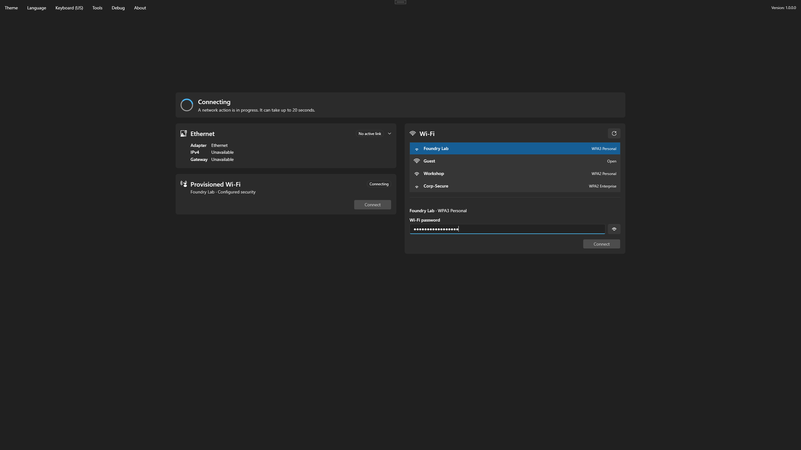

# Foundry Connect

Foundry Connect opens after the startup console on a target device started from deployment media. It gets the device online in Windows PE and holds the startup until Internet access is confirmed, because the startup then needs GitHub to get Foundry Deploy.

<figure>
  
  <figcaption>One page: the status at the top, then one card per connection. The menu bar is at the top left and the version at the top right.</figcaption>
</figure>

Most of the time you do nothing. With a cable and DHCP, or with a network profile that the administrator put on the media, the status changes from **Checking the network** to **Network ready** by itself.

## What the page shows

The status area at the top says where the device stands:

| Status | Meaning |
| --- | --- |
| **Checking the network** | Foundry Connect has just opened and reads the state of the adapters. |
| **Connecting** | A network action is running, for example a Wi-Fi connection. It can take up to 20 seconds. |
| **No internet access** | The device is not online yet. The line under the title gives the reason, and **Retry** and **Export diagnostics...** appear. |
| **Network ready** | Internet access has been validated. Under it, **Ethernet**, **Wi-Fi ·** or **Provisioned Wi-Fi ·** followed by the network name tells which connection is used. |

Under the status, each card appears only when it has something to show:

- **Ethernet**: the wired adapter, its address and, when the media carries one, the 802.1X authentication. The card folds to one line once the device has an address; select it to see the details.
- **Provisioned Wi-Fi**: the Wi-Fi profile that the administrator put on the media.
- **Wi-Fi**: the networks in range, to join one yourself.

When the device has no wired adapter, or Wi-Fi cannot work, a single line says so instead of an empty card. [Network readiness](network-readiness.md) explains every card and status.

## Continue to Foundry Deploy

When **Network ready** appears, Foundry Connect shows "Continuing automatically in 10s" and counts down, then closes and the startup continues. You can:

- Select **Continue** to go on at once.
- Select **Stay here** to stop the countdown. It does not start again: select **Continue** when you are ready.

The countdown also stops as soon as you work on the network, for example when you select a Wi-Fi network, type a password, connect or disconnect. It then reads "Automatic continue is paused because you changed network settings." If you worked on the network before Internet access came, the countdown does not start at all: **Continue** is offered and waits for you. Enter pressed in the Wi-Fi list or in the password box acts on the Wi-Fi only: it never sends you to Foundry Deploy.

Before it closes, Foundry Connect checks Internet access once more. If the connection dropped, it stays open and waits for **Network ready** again.

When Internet access cannot be reached, there is no way to continue without it. Use **Retry** after you fixed the cause, or **Export diagnostics...** to take the logs to support. See [Network and Foundry Connect troubleshooting](../troubleshooting/network.md).


Do not close Foundry Connect to get past it. Closing the window cancels the startup: Foundry Deploy does not open. See ["Boot was cancelled. Deployment will not continue."](../troubleshooting/windows-pe-startup.md#boot-cancelled) to start again.


## Deployment password in Foundry Connect 

When the administrator put a Wi-Fi passphrase, a client certificate, or an enterprise profile file that contains key material on the media, these network settings are protected by the Deployment password. Foundry Connect asks for the password in a window titled **Protected network settings**, under the heading **Password required**, and only when it needs these settings:

- At startup, when wired 802.1X uses a client certificate.
- For the provisioned Wi-Fi, once per session at most, when the device has no Internet access and the network is in range. While Ethernet gives Internet access, no password is asked. Once you connected or disconnected a network yourself, Foundry Connect no longer connects the profile by itself, so it no longer asks by itself either.
- When you select **Connect** on a **Provisioned Wi-Fi** card that shows **Password required**.

Type the password in **Deployment password** and select **Continue**. A wrong password reopens the window with "The password is incorrect. Try again." after a short wait: one second more for each failed attempt, up to five seconds.

One correct entry unlocks every protected network setting for the session, and [Foundry Deploy](../foundry-deploy/README.md#open-foundry-deploy) then opens without asking for the password again. If Foundry Deploy still asks, type the same password.

**Cancel** leaves the protected settings unused for the session: wired 802.1X shows **Unavailable**, and the provisioned Wi-Fi stays on **Password required** and is not asked for again by itself. Its **Connect** button asks again. Plain Ethernet and the other Wi-Fi networks keep working, and Foundry Deploy asks for the password when it opens.

While the window is open, Foundry Connect never continues by itself. Afterwards, select **Continue** in the status area when **Network ready** appears.

## Menus

| Menu | Use it to |
| --- | --- |
| **Theme**, **Language** | Change the appearance or the display language. Foundry Deploy opens with the same theme and language. |
| **Keyboard** | Change the keyboard layout of Windows PE, for example before typing a Wi-Fi password. The menu name shows the active layout. It lists the layouts of the same language first, and every other language under **Other languages**. Foundry Deploy keeps the layout chosen here. |
| **Tools > Refresh status** | Check the network now instead of waiting for the next automatic check. Foundry Connect checks every 10 seconds. |
| **Tools > Open log file** | Read the Foundry Connect log in Notepad. |
| **Tools > Export diagnostics...** | Save the logs to the USB drive for support. See [Export logs from Foundry Connect and Foundry Deploy](../troubleshooting/logs-and-support.md#export-logs-from-foundry-connect-and-foundry-deploy). |
| **Tools > Export raw diagnostics...** | Save the logs without masking. Use it only when a support contact you trust asks for it. |

Press Alt to show the underlined letter of each menu, then press that letter to open it. The version of Foundry Connect is shown at the top right of the window.

## Where to go next

| I want to | Go to |
| --- | --- |
| Understand the console that appears before Foundry Connect | [Windows PE startup](windows-pe-startup.md) |
| Connect to Wi-Fi, or read a status on screen | [Network readiness](network-readiness.md) |
| Fix a device that shows **No internet access** | [Network and Foundry Connect troubleshooting](../troubleshooting/network.md) |
| Continue after **Network ready** | [Foundry Deploy](../foundry-deploy/README.md) |
