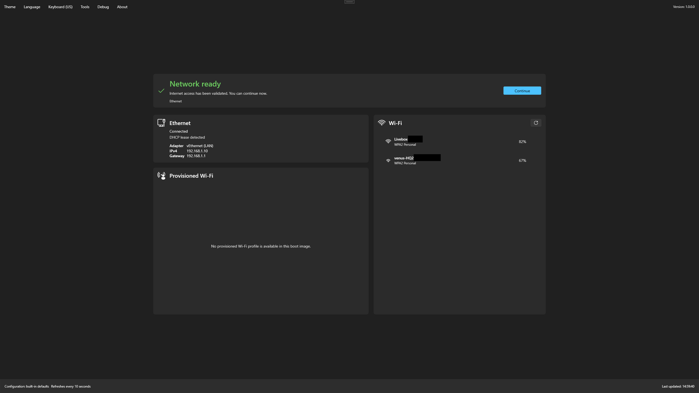

# Network readiness

Foundry Connect shows the state of the wired and wireless connections of the target device, and lets you continue once it has reached the Internet.

<figure>
  
  <figcaption>Once Internet access is validated, <strong>Continue</strong> closes Foundry Connect and the startup continues to Foundry Deploy. <strong>Stay here</strong> stops the countdown.</figcaption>
</figure>

## Join a Wi-Fi network

With a cable and DHCP, or a profile from the media, you have nothing to do. To join a Wi-Fi network yourself:

1. In the **Wi-Fi** card, select the network in the list. Use the refresh button next to the card title if it is missing.
2. Under the list, type its password in **Wi-Fi password**. The eye button shows what you typed.
3. Select **Connect**, or press Enter in the password box. **Connect** stays unavailable until you type a password, except on an open or Enhanced Open network.

<figure>
  
  <figcaption>The details of the selected network sit under the list.</figcaption>
</figure>

Once the network is connected, the same button reads **Disconnect**, and the list shows **Connected** next to the network.

With the keyboard only, Tab moves into the list, the arrow keys choose a network, and Tab again reaches the password box and **Connect** under the list. The list keeps its order while a network is selected, so a new scan never moves the row you are on.

The **Wi-Fi** card appears only when the media was created with Wi-Fi enabled and Windows PE could start its wireless service. You can join open, Enhanced Open, WPA2 Personal and WPA3 Personal networks. The password has 8 to 63 characters. Other networks are listed but cannot be joined from here; when you select one, the line under the list gives the reason and there is no password box and no button:

- An enterprise network needs a profile from the media: "This network requires a provisioned Wi-Fi profile."
- A WEP or WPA Personal network is refused: "This Wi-Fi network is not supported in this build."
- A selected network that the adapter no longer sees shows **Not in range**.
- A network that hides its name is not listed at all. To use one, the administrator puts its profile on the media.

When [Windows profile roaming](../foundry-osd/network/README.md#windows-profile-roaming) is on for Wi-Fi, every network you join successfully here is also set up in the installed Windows, even if the cable stays connected. Type only a password that may stay on the device.

## Use the provisioned Wi-Fi

The **Provisioned Wi-Fi** card shows the profile that the administrator put on the media: its name and its security on one line, its status, and one **Connect** button, which reads **Disconnect** while the profile is connected.

While the device has no Internet access, Foundry Connect connects this profile by itself, and tries again about every 20 seconds at first, then less and less often, up to every 2 minutes. A working cable is used first: while Ethernet gives Internet access, Foundry Connect does not try the profile.

As soon as you connect or disconnect a network yourself, Foundry Connect stops trying the provisioned profile for the rest of the session, so it never takes back a connection you chose. The **Connect** button of the card stays available: select it to use the profile again.

When the profile cannot be used from this media, the card shows **Unavailable** and the reason, without a button. The other connections are not affected. See [Provisioned Wi-Fi "Unavailable"](../troubleshooting/network.md#provisioned-wifi-unavailable).

When the profile is protected by the Deployment password, because it carries a passphrase, a client certificate, or an enterprise profile file that contains key material, the card shows **Password required** and "The provisioned Wi-Fi is protected by the deployment password. Select Connect to enter it." Foundry Connect asks for the [Deployment password](README.md#deployment-password-in-foundry-connect) by itself once, when it would otherwise connect the profile, and each time you select **Connect** while the card shows **Password required**. After a correct entry, the profile connects as described above. After **Cancel**, the card reads "The deployment password was not entered. Select Connect to enter it." and Foundry Connect no longer asks by itself.

## What Network ready tests

Every 10 seconds, and when you select **Retry** or **Tools > Refresh status**, Foundry Connect asks two Microsoft test addresses, `www.msftconnecttest.com` and `www.msftncsi.com`, for a known answer. **Network ready** appears only when one of them sends exactly that answer within 5 seconds.

Any other answer means that something on the network intercepts web traffic, such as a sign-in page or a proxy that asks for credentials. The status banner then reads **Sign-in required** with "The network answered with a sign-in page instead of internet access.", followed by what to do: Windows PE has no browser to sign in.

The test cannot be changed or skipped. **Network ready** does not prove that the other hosts in [Network endpoints](../reference/network-endpoints.md) are reachable.

## What the statuses mean

The title of the status banner names the state or, while the device is not online, the cause. The line under the title says what to do.

| On screen | Meaning | What to do |
| --- | --- | --- |
| **Checking the network** | Foundry Connect has just opened, or a network has just connected and Internet access has not answered yet. | Wait a few seconds. |
| **Connecting**, "Applying the network settings from the boot media." | Foundry Connect is installing the profiles and certificates from the media. | Wait. |
| **Connecting**, "A network action is in progress. It can take up to 20 seconds." | A Wi-Fi network is being connected. | Wait. |
| **Connecting**, "Wired 802.1X authentication is in progress." | The network is checking the device on the wired port. | Wait. **Retry** checks the state again; it does not restart the authentication. |
| **Disconnecting** | A Wi-Fi network is being disconnected. | Wait. |
| **No network adapter** | Windows PE sees no usable network adapter. | See ["Ethernet isn't available on this device."](../troubleshooting/network.md#no-ethernet-adapter) |
| **No Ethernet cable** | The wired adapter has no link, and Wi-Fi cannot be used. | See ["No active link"](../troubleshooting/network.md#no-active-link). |
| **No network connection** | No cable is connected and no Wi-Fi network is joined. | Connect a cable or join a Wi-Fi network. See ["No active link"](../troubleshooting/network.md#no-active-link). |
| **Wired 802.1X authentication did not succeed** | The wired port refused the device or the 802.1X settings could not be used. | Read the reason under **802.1X** in the **Ethernet** card. See ["Authentication failed"](../troubleshooting/network.md#wired-authentication-fails). |
| **No IP address** | The cable is connected, but the network gave no address. | See ["Waiting for network configuration"](../troubleshooting/network.md#waiting-for-network-configuration). |
| **Sign-in required** | The network answered with a sign-in page. | See ["Sign-in required"](../troubleshooting/network.md#captive-portal). |
| **No internet access** | The device is connected but cannot reach the test addresses. | See ["The network is connected but cannot reach the internet."](../troubleshooting/network.md#internet-not-validated) |
| **Network ready** with **Ethernet**, **Wi-Fi ·** name or **Provisioned Wi-Fi ·** name next to the title | A test address answered through this connection. | Select **Continue** or wait. |

Ethernet card

| On screen | Meaning |
| --- | --- |
| "Ethernet isn't available on this device." | Windows PE sees no wired adapter, for example in a virtual machine without a network adapter, or when the driver of the adapter is not in the image. The card shows only this line. |
| **No active link** | The adapter has no link: cable, dock or switch port. |
| **Waiting for network configuration** | The link is up but the adapter has no usable address yet. |
| **Waiting for network configuration**, "Self-assigned address" | Windows gave the adapter an address itself because no DHCP server answered. |
| **Connected** and the address under the title | The adapter has a usable address. |
| **Adapter**, **IPv4**, **Gateway**, **IP assignment** | The details of the wired adapter, folded until you open them. **IP assignment** reads "DHCP lease detected" or "Static network configuration detected". **Unavailable** when there is nothing to show. |
| **802.1X**: **Authenticating** | The media carries a wired 802.1X profile and the network is checking the device. |
| **802.1X**: **Authenticated** | The network accepted the device. |
| **802.1X**: **Profile applied** | The profile is in place, but the result of the authentication cannot be read. An address under **IPv4** means it worked. |
| **802.1X**: **Authentication failed** | The profile from the media is missing, or the profile or the network refused the device. A line under **802.1X** gives the reason. |
| **802.1X**: **Unavailable** | The profile is not used: the Deployment password was not entered, or a secret of the profile cannot be read from this media. A line under **802.1X** gives the reason. |

Wi-Fi and Provisioned Wi-Fi cards

| On screen | Meaning |
| --- | --- |
| "Wi-Fi isn't available on this device." | Windows PE cannot use a wireless adapter. The line replaces the list, and the **Provisioned Wi-Fi** card is hidden until Wi-Fi works again. |
| "No Wi-Fi networks are currently visible." | No network in range. Select the refresh button next to the card title. |
| A dimmed network in the list, **Not in range** under the list | The selected network is no longer seen by the adapter. It stays selected but cannot be connected. |
| **Connected** next to a network in the list | The device uses this network. Select it to see **Disconnect** under the list. |
| **Not in range** | The provisioned network is not seen by the adapter. |
| **Ready to connect** | The provisioned profile is not connected yet. |
| **Connecting** | The provisioned profile is being connected. |
| **Password required** | The provisioned profile waits for the Deployment password. Select **Connect** to enter it. |
| **Unavailable** | The provisioned profile cannot be used from this media. The line under it gives the reason. |
| **Connected** | The device uses the provisioned profile. |
| **Another Wi-Fi network is active** | The device uses a network you joined from the list, not the provisioned profile. This is not an error. |
| **Open**, **Enhanced Open**, **WEP**, **WPA Personal**, **WPA2 Personal**, **WPA3 Personal**, **WPA2/WPA3 Personal**, **WPA Enterprise**, **WPA2 Enterprise**, **WPA3 Enterprise**, **Enterprise**, **Vendor-specific** | The security of the network or of the provisioned profile. **Configured security** means a profile whose security is not shown. |

## If you cannot continue

Find the text you see on screen in [Network and Foundry Connect troubleshooting](../troubleshooting/network.md).

## Next step

The [startup console](windows-pe-startup.md) prepares Foundry Deploy, then [Foundry Deploy](../foundry-deploy/README.md) opens.
