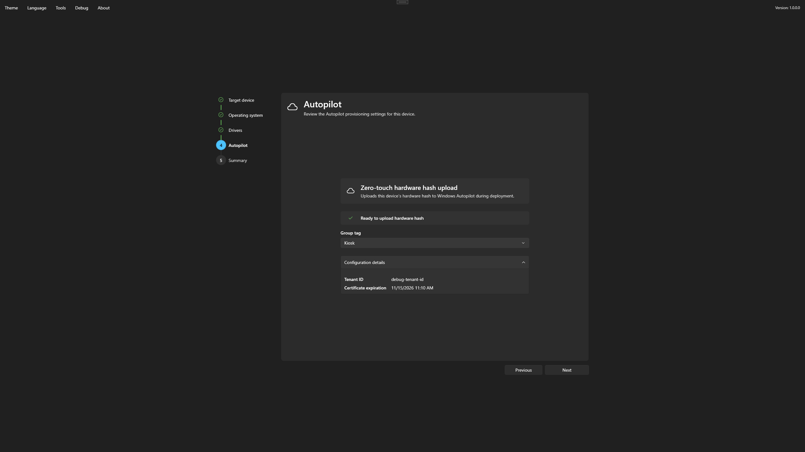
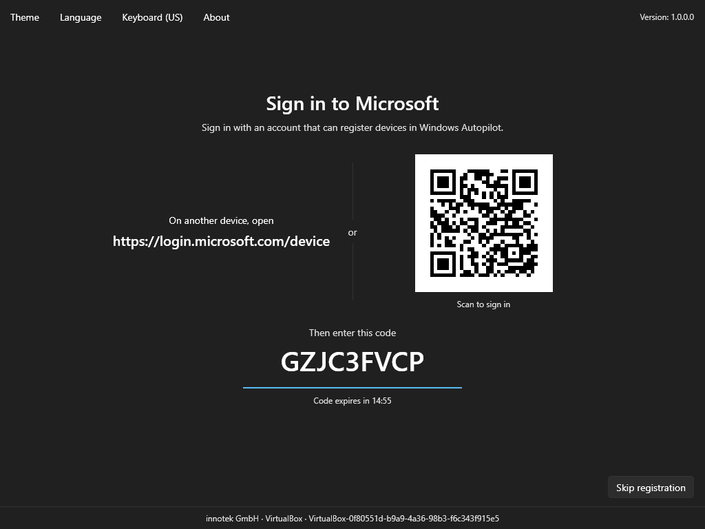
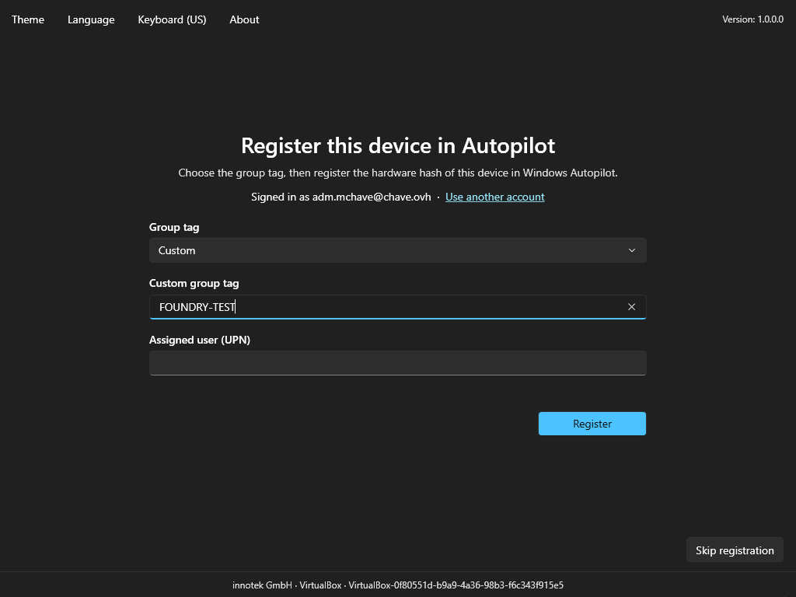

# Windows Autopilot step

On media prepared for Windows Autopilot, Foundry Deploy shows an **Autopilot** step between **Drivers** and **Summary**, then does the Autopilot work near the end of the deployment. With the interactive mode there is no wizard step: you register the device yourself after the restart.

<figure>
  
  <figcaption>Choose a group tag if the media offers several. <strong>Configuration details</strong> shows the tenant and when the certificate expires.</figcaption>
</figure>

## Which mode the media uses

**Provisioning method**, under **Autopilot** on **Summary**, names the mode. When the wizard has an **Autopilot** step, the card at its top names it too.

| Mode | In the wizard | In **Steps**, during the deployment |
| --- | --- | --- |
| JSON profile | **Autopilot** step: choose the profile | **Copy Autopilot profile** copies the profile into the installed Windows. |
| Zero-touch hardware hash upload | **Autopilot** step: check the status and choose the group tag | **Register Autopilot device** reads the hardware hash, uploads it, then waits for the device to appear in the tenant. |
| Interactive hardware hash upload | No step | **Prepare Autopilot assistant** downloads Foundry Autopilot Interactive into the installed Windows, for the window that opens after the restart. Nothing is uploaded yet: you [register the device after the restart](#register-the-device-after-the-restart). |

## Complete the step

1. **JSON profile:** in **Profile**, keep the preselected profile or choose another profile of the media.
2. **Zero-touch:** read the status, then choose the **Group tag**. Keep **None** only for a device that must have no tag: on a device that is already registered, **None** removes its current tag. You cannot type a tag.
3. Select **Next**.

| What you see | Meaning |
| --- | --- |
| **Ready to upload hardware hash** | The upload will be attempted at the end of the deployment. |
| **Hardware hash upload unavailable** | The certificate of the media has expired or is incomplete, and the **Group tag** list is hidden. You can deploy, but the device will not be registered. Tell the administrator. |
| **Configuration details** | **Tenant ID** and **Certificate expiration** of the media. |
| "No embedded Autopilot profiles were found on this media." | The media has no profile and **Next** stays unavailable. The administrator must create the media again. |

When Foundry Deploy could not read the group tags from the tenant at startup, the list holds only the tags saved on the media. This does not stop the deployment.

## During the deployment

In **Steps**, the Autopilot step is the last one before **Finalize deployment**. Windows is already on the disk when it runs.

**Register Autopilot device** can last 10 minutes while it reads "Waiting for Autopilot device visibility..." with a countdown, and up to 10 more to confirm the group tag or the computer name. Keep the network connected.

- **When Register Autopilot device is skipped**, a skipped icon appears next to its name in **Steps** and the deployment still ends on **Deployment complete**. Windows is installed, but the device is not registered, or is registered without its group tag or name. Point at the step to read the reason in a tooltip, and note it before the restart.
- **When the step fails**, the deployment stops on **Deployment failed**, which reads "Failed step: Provision Autopilot" for the three modes. For **Register Autopilot device** this happens when the file `PCPKsp.dll` of the installed Windows is missing, cannot be copied, cannot be registered or cannot be loaded. **Copy Autopilot profile** and **Prepare Autopilot assistant** are never skipped: any problem there stops the deployment.

In interactive mode, the deployment checks before it touches the disk that the Foundry Autopilot Interactive download is available, and stops with a message if it is not. The device needs Internet access in Windows PE for this.

Each reason is explained in [Windows Autopilot troubleshooting during deployment](../troubleshooting/autopilot/during-deployment.md).

## Register the device after the restart

Interactive mode only. After the restart, during Windows setup and before the first sign-in screens, the **Foundry Post-installation** console runs the line `Upload hardware hash to Windows Autopilot` and **Foundry Autopilot Interactive** opens full screen in front of it. The window has no title bar and follows the language, theme and keyboard you used in Foundry Deploy. At the bottom of both pages it shows the manufacturer, model and serial number of the device, and the computer name when it is known. Windows setup waits for the window, for up to 120 minutes.

<figure>
  
  <figcaption>Scan the QR code, or open the address on another device and type the code. The code shown here is an example.</figcaption>
</figure>

1. **Sign in.** Check the network: while the window says the network is not available, connect the device. It tries again every 10 seconds. Then, on another device, scan the QR code, which opens the Microsoft sign-in page, normally with the code already filled in. If the code box is empty, type the code shown in the window. Or open the address shown, type the code and sign in with your account. When the countdown ends, the code and the QR code are replaced together, so always use what is on screen.
2. When the window changes to **Register this device in Autopilot**, check **Signed in as**. Select **Use another account** to sign in again with another account.
3. Choose the **Group tag**: **None**, a tag already used in the tenant, or **Custom** to type one in **Custom group tag**. If the window says "This device is already registered in Windows Autopilot", its current group tag is preselected: **None** removes it. The administrator can have **Custom** preselected for devices that are not registered yet.
   If the window warns "Several Windows Autopilot devices have this serial number", nothing is preselected and the registration cannot update that device: remove the duplicates in your tenant first.
4. When the administrator offers it, type the **Assigned user (UPN)**, such as `user@contoso.com`, or leave it empty. An empty box never removes a user already assigned to a device that is registered.
5. Select **Register**. The window reports each stage, then waits for the device to appear in Windows Autopilot, for up to 15 minutes.

<figure>
  
  <figcaption>Choose the group tag, then select <strong>Register</strong>.</figcaption>
</figure>

6. The window then reads "Waiting for the Autopilot profile assignment", for up to 20 minutes, while your tenant assigns the profile. Select **Continue without waiting** to stop waiting.
7. When it reads "Registration completed" and "Continuing Windows setup in 10 seconds", the registration has succeeded. Select **Continue now** to go on at once. Windows setup then continues to its first-run screens (OOBE), without a restart.

<figure>
  
  <figcaption>After 10 seconds, or with <strong>Continue now</strong>, Windows setup continues.</figcaption>
</figure>

If the registration fails, the reason stays in the window and the controls become available again: correct the cause, then select **Register** again. The window gives explicit messages when the device is registered in another tenant, when it is a duplicate, when the account lacks an Intune role that can import Autopilot devices, and when the group tag, computer name or user could not be applied to a device that is registered. For a sign-in that fails, select **Retry** to get a new code.

To leave without registering, select **Skip registration**, at the bottom of either page, or close the window with Alt+F4, then confirm. Windows setup continues and the device is not registered. If you skip while the registration is in progress, the device may still appear in Windows Autopilot: check your tenant. If you do nothing, the window ends by itself after 120 minutes, and Windows setup continues without registering the device. See [Windows Autopilot troubleshooting after the restart](../troubleshooting/autopilot/after-the-restart.md).

Next: [Review and deploy](review-and-deploy.md) in the wizard, and [After the restart](after-the-restart.md) for everything else that happens after the restart.
