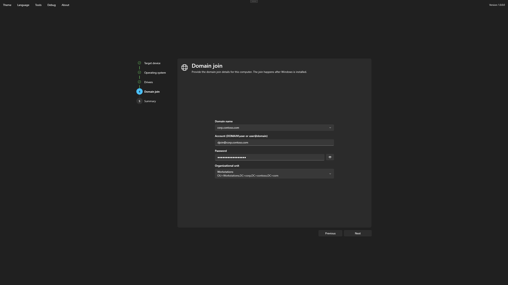

# Domain Join step

On media prepared for Domain Join, Foundry Deploy shows a **Domain join** step between **Drivers** and **Summary**. You choose the domain and the organizational unit (OU) and, on interactive media, enter the join account. You can also [deploy the computer without joining a domain](#deploy-without-joining-a-domain). The join itself runs later, in installed Windows, after the restart.

<figure>
  
  <figcaption>Interactive media asks for the join account and its password. The <strong>Domain name</strong> list also offers <strong>Do not join a domain</strong>.</figcaption>
</figure>

## Before you start

- On interactive media, have the join account and its password.
- Check the computer name on [Target device](target.md): it identifies the computer account, and a device redeployed under the same name reuses its account.

## Complete the step

1. **Domain name**: the list holds the domains of the media, and the default is preselected. On interactive media that lists no domain, keep **Join a domain** and type the DNS name of the domain, such as `corp.contoso.com`, in the field below.
2. **Account (DOMAIN\user or user@domain)** and **Password**: on interactive media, enter the join account and its password. Zero-touch media carries the account and does not show these fields.
3. **Organizational unit**: choose the OU when the domain lists several; the default, if there is one, is preselected. A domain with a single OU uses it without asking.
4. **OU distinguished name (optional)**: shown on interactive media for a domain without listed OUs. Type an OU of that domain, starting with `OU=`, or leave it empty to use the domain's default location.
5. Select **Next**. It stays unavailable while a required field is empty, a field shows a message, or the domain refused the join account. See [Account check](#account-check).

Changing the domain replaces the OU choices and keeps the account and password you typed.

## Account check

Foundry Deploy checks the join account and its password with a domain controller before the deployment starts. While it runs, "Checking the account with the domain..." shows at the bottom of the step, and the wizard stays on the step. The result shows in the same place. **Do not join a domain** never contacts the domain.

### On interactive media

**Next** checks the account and the password you typed before the wizard moves on.

- **The domain accepts them:** the wizard moves to the next step.
- **The domain refuses them:** a message gives the reason, and **Next** stays unavailable until you change the domain, the account or the password. The account may be wrong or have a wrong password, be locked out, have an expired password, or be disabled. See [The Domain join step does not let you continue](../troubleshooting/domain-join.md#step-blocked).
- **The domain cannot be reached, or does not give a clear answer:** a warning shows. Select **Next** again to continue without the check; a mistyped password then only shows after the restart, as a failed join. See [The account was not checked](../troubleshooting/domain-join.md#credentials-not-checked).

When you change the domain, the account or the password after a check, the next **Next** checks again, and so does **Start deployment** after a change made from **Summary**.

### On zero-touch media

The check runs by itself as soon as the step is shown, with the account stored on the media for the selected domain, and again when you choose another domain.

- **The domain accepts the account:** nothing more shows, and **Next** is available.
- **The domain refuses the account:** a message says that the join account stored on the media was refused, locked out, expired or disabled, and that the administrator must correct it in Foundry OSD and create the media again. **Next** stays unavailable. Choose another domain, or **Do not join a domain** to deploy this computer without the join. See [The join account stored on the media is refused](../troubleshooting/domain-join.md#media-account-refused).
- **The domain cannot be reached, or does not give a clear answer:** a warning shows, and **Next** stays available. A wrong password stored on the media then only shows after the restart, as a failed join.

If the check could not run on the step, **Start deployment** runs it before anything is written to the disk, and a refusal stops the deployment with the same message.


The check proves only the account and the password. The join can still fail after the restart on the permissions of the account in the OU, on the number of computers the account may add to the domain, or on an existing computer account that another user created.


## Deploy without joining a domain

The last entry of **Domain name** is **Do not join a domain**. Choose it to deploy this computer outside the domain, although the media is prepared for Domain Join.

- The other fields disappear and **Next** is available.
- Foundry Deploy prepares no join: Windows is installed as from media without Domain Join, and the checks in [Before you hand over the device](#before-you-hand-over-the-device) do not apply.
- A password you already typed is erased. If you choose a domain again, type it again.

**Do not join a domain** is never preselected: the computer joins the domain unless you choose otherwise.

## When the step is not shown

A Windows Home edition cannot join a domain, so the step is not shown. **Summary** and **Confirm disk erase** then say: "This Windows edition cannot join a domain. Windows installation continues without it."

## Review on Summary

The **Domain join** category shows the **Domain name** and the **Organizational unit**; **Domain default location** means no OU applies. It shows **Do not join a domain** when that is your choice. When the wizard has a **Domain join** step, **Edit** returns to it. The account and the password are never shown.

If the deployment does not start, see [Domain Join troubleshooting](../troubleshooting/domain-join.md). Otherwise continue with [Review and deploy](review-and-deploy.md), and come back to the checks below after the restart.

## Before you hand over the device

A deployment that succeeds in Windows PE has prepared the join, not performed it.

1. Keep power and network connected: installed Windows must reach a domain controller, and it restarts once more after a successful join.
2. Read the **Foundry Post-installation** console, which appears on screen by itself after the restart. Its two lines that start with `Domain -` and `Restart:` report the join. [Domain Join lines](after-the-restart.md#domain-join-lines) shows what they read when the join is complete, and when to read them.
3. Look at the first screen after setup. What it proves depends on the media; the administrator who created it knows which case applies.
    - No local account and no custom answer file: the Windows sign-in screen means the join is confirmed, and **Who's going to use this device?** means it failed or could not be confirmed.
    - A local account configured on [OOBE](../foundry-osd/customization/oobe.md), or a custom answer file: the first screen proves nothing. Rely on the console lines.
4. Sign in with a domain account, and have your Active Directory administrator confirm that the computer account is in the intended OU.

For any other value or a yellow line under the two lines, see [Domain Join troubleshooting](../troubleshooting/domain-join.md).
