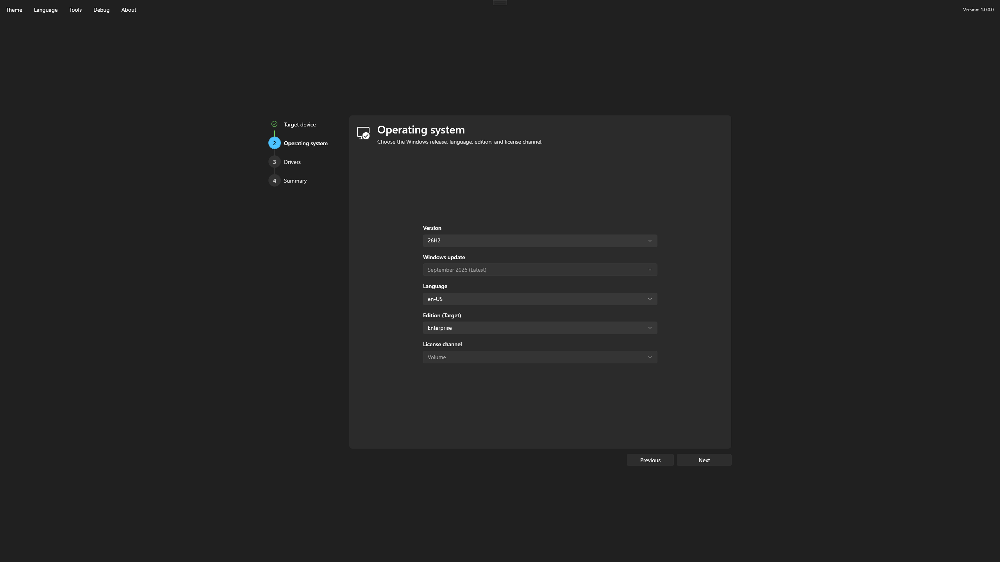

# Select Windows

On **Operating system**, the second step of the wizard, you choose the Windows image to install: one from the Windows catalog or, when the media provides them, a custom image.

<figure>
  
  <figcaption>The five fields of the <strong>Operating system</strong> step.</figcaption>
</figure>

## Select a catalog image

1. If **Image source** is shown, keep **Windows catalog**. The selector appears only when the administrator enabled custom images.
2. In **Version**, select the Windows 11 release, for example 25H2.
3. In **Windows update**, keep the entry marked **(Latest)** unless you need an earlier monthly update.
4. In **Language**, select the Windows display language.
5. In **Edition (Target)**, select the edition to install.
6. In **License channel**, select **Retail** or **Volume**.
7. Select **Next**.

Each field narrows the next one, so set them from top to bottom.

| Field | What it means |
| --- | --- |
| **Version** | The Windows 11 release. Foundry supports 24H2, 25H2 and 26H2: see [Supported versions](../reference/supported-versions.md). |
| **Windows update** | The monthly update level of the image, named by month and year. The newest one is marked **(Latest)**. |
| **Language** | Pre-selected from the administrator's default, then from the Windows PE language, then `en-US`. |
| **License channel** | **Retail** or **Volume**. Foundry attempts automatic activation only for Retail images: see [After the restart](after-the-restart.md). |

A field that is greyed out offers a single value: the administrator restricted it in [OS selection](../foundry-osd/customization/operating-system.md), or the catalog has only one choice.


A restriction applies only while the catalog still contains one of the allowed values. If none of the allowed versions, languages, editions or license channels exists in the catalog for the current selection, Foundry Deploy offers every catalog value for that field instead of blocking the deployment. Check all five fields before you continue, and again in the summary.


## Select a custom image 

1. In **Image source**, select **Custom image**.
2. In **Image**, keep the selected image or choose another one. The administrator's preferred image is selected; without one, the first image is. The drive or the [network cache](../foundry-osd/network-cache.md) share it comes from is shown beside its name.
3. In **Image index**, keep the selected index or choose another one. Only the indexes built for the architecture of this device are listed. The preferred index is selected; without one, the first index built for this device is.
4. Check the read-only **Version**, **Edition**, **Architecture** and **Language** fields: they describe the selected index.
5. Select **Next**.

Points to know:

- Two indexes can carry the same edition name. The index number is what Foundry installs.
- Keep the drive that holds the image connected until the deployment ends. An image from a network cache share is copied to the disk after **Prepare target disk**.
- A WIM file [added to the USB drive by hand](../foundry-osd/customization/custom-windows-images.md#add-an-image-to-a-usb-drive-by-hand) after Foundry Deploy opened is found when you select **Windows catalog** and then **Custom image** again.
- The administrator's catalog restrictions do not filter custom images.
- Foundry does not attempt automatic activation for a custom image.

How custom images are added to the media is described in [Custom Windows images](../foundry-osd/customization/custom-windows-images.md).

## If something stops you

A message under the image selectors, such as "The configured default image or index is unavailable. Choose an image and index explicitly.", blocks **Next** until you select an image and an index yourself. This message and the others are explained in [Before the deployment starts](../troubleshooting/deployment/before-deployment-starts.md).

Next: [Select a driver pack](driver-pack.md).
