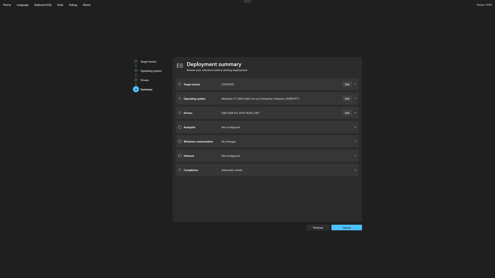
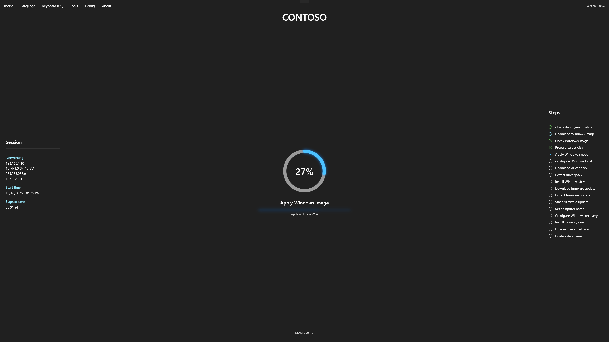

# Review and deploy

On **Summary**, the last step of the wizard, you check every choice, start the deployment and follow it to the end.

<figure>
  
  <figcaption>Each category sums up one step or one media setting. <strong>Edit</strong> appears on the categories you can change in the wizard.</figcaption>
</figure>

## Review the summary

| Category | Check |
| --- | --- |
| **Target device** | Answer file, computer name, target disk, firmware updates and the detected hardware |
| **Operating system** | Release, edition, architecture, language, license channel and build, or the custom image and its index |
| **Drivers** | Driver source and, for a manufacturer, the model and pack version, or, for custom drivers, the driver set |
| **Autopilot** | Provisioning method and the profile or group tag |
| **Domain join** | Domain and organizational unit, or **Do not join a domain**. Listed only when the media uses Domain Join |
| **Windows customization** | Windows setup options, application and AI component removal, optional features |
| **Network** | Whether the Wi-Fi and wired 802.1X profiles are copied to Windows, and whether **Private-key material** is included |
| **Completion** | **Restart behavior** and, for an automatic restart, **Restart delay** |

To change a value, select **Edit** on its category, correct the step, then select **Return to summary**.

A **Status** row under **Target device** or **Drivers** reports something that blocks **Deploy**, or the reason **Deploy** returned you to the summary: for example "\<manufacturer>: no matching model or version" under **Drivers**. See [Before the deployment starts](../troubleshooting/deployment/before-deployment-starts.md). Under **Domain join**, **Status** only says that this Windows edition cannot join a domain. Under **Windows customization**, **Status** only says whether anything is configured.

## Start the deployment


Selecting **Yes** in **Confirm disk erase** erases the disk it names. This is the point of no return for the data on that disk.


1. Select **Deploy**.
2. Read **Confirm disk erase**. It names the disk number, model, bus and size, and the operating system to install.
3. Select **Yes** only if the disk is the right one. **No** returns to the summary and changes nothing.

From then on, keep the device powered, the network connected and the deployment media in place until the deployment ends.

## Follow progress

<figure>
  
  <figcaption>Point at a step in <strong>Steps</strong> to read its result, or why it was skipped.</figcaption>
</figure>

The progress page shows the computer name, the overall percentage, the current step and its own progress, and a counter such as "Step: 7 of 20". **Session** shows the network addresses, **Start time** and **Elapsed time**. **Steps** lists every step of this deployment with an icon next to its name. Each state has its own icon and no word names it: point at a step to read its result, or the reason it was skipped, in a tooltip.

| Step state | Icon | Meaning |
| --- | --- | --- |
| Not started | Empty circle | The step has not run yet. |
| Running | Blue dot | The step is in progress. |
| Completed | Green check mark in a circle | The step did its work. **Stage driver installer**, **Stage firmware update**, **Prepare setup tasks** and **Prepare Autopilot assistant** only prepared work that runs in Windows after the restart. |
| Skipped | Blue "i" in a circle | The step had nothing to do, or could not do optional work, and the deployment continues. Read the reason. |
| Failed | Red cross in a circle | The deployment stopped at this step. See [Verify deployment](verify-deployment.md). |
| Canceled | Cross without a circle | You cancelled while this step was running. |

The number of steps depends on the media configuration and can change while the deployment runs, for example when no driver is found. It does not measure the remaining time.

### What is checked before the disk is erased

**Prepare target disk** is the step that erases the disk. Everything listed above it in **Steps** runs first, and a failure there leaves the disk untouched. Foundry Deploy first checks the disk, the storage space it can calculate, the answer file and the post-installation content the media must carry.

- **USB drive with enough free cache space, or a custom image on the ISO or USB drive:** the Windows image is downloaded or reused and checked before **Prepare target disk**.
- **ISO or PXE, a USB drive whose cache cannot hold the image, or a custom image from the [network cache](../foundry-osd/network-cache.md):** only access to the source is checked first (for a custom image from the share: its signed publication, its size and its editions). **Download Windows image** copies the image to the disk and checks it, and **Check Windows image** runs, after **Prepare target disk**, so a download or image problem can stop a deployment whose disk is already erased. The share is read once, during the copy.

Checking a large cached image takes time, especially on a slow USB drive. The step shows "Checking cache..." with a percentage: let it finish.

### Automatic retries

A download that fails on a connection error or a temporary server error is retried up to five times, ten seconds apart, before the step fails; a certificate error is not retried. What each download message means is in [Checks and image download](../troubleshooting/deployment/checks-and-image-download.md).

## Deployment steps

Every step, in order, with its condition

The order below is the one used when the Windows image is checked before the disk is erased. On the other route, **Prepare target disk** comes before **Download Windows image**. For a catalog image, **Steps** lists **Prepare target disk** before **Download Windows image** until **Check deployment setup** has finished; the list is then put in the order that applies. The "Failed step: ..." line of the error screen uses the names below, with two exceptions noted in the table.

| Step | Runs when | If it is skipped |
| --- | --- | --- |
| **Validate answer file** | A custom answer file is selected | Not skipped |
| **Check deployment setup** | Always | Not skipped |
| **Download Windows image** | A catalog image is selected | The image was in the cache and passed verification |
| **Resolve custom image** | A custom image is selected. Replaces **Download Windows image**; the error screen still names it "Download Windows image" | Always shown as skipped: the image is read from the deployment media |
| **Check Windows image** | Always | Not skipped |
| **Prepare target disk** | Always. Erases and partitions the disk | Not skipped |
| **Apply Windows image** | Always | Not skipped |
| **Configure Windows boot** | Always | Not skipped |
| **Copy answer file** | A custom answer file is selected | Not skipped |
| **Download driver pack** | **Driver source** is not **None** | The pack was in the cache, or Microsoft Update Catalog was unreachable or had no driver: the deployment continues without those drivers |
| **Extract driver pack**, **Install Windows drivers** | The drivers can be added to Windows before the restart | Removed from the list when Microsoft Update Catalog returned nothing |
| **Stage driver installer** | The pack is an installer that runs after the restart (Lenovo `.exe`, Surface `.msi`) | Not skipped |
| **Stage custom drivers** | **Driver source** is **Custom drivers** | Not skipped |
| **Download firmware update** | **Apply firmware updates** is checked on a physical device | The device runs on battery, reports no firmware identifier, has no update in Microsoft Update Catalog, or the catalog is unreachable. Also when the update was in the cache |
| **Extract firmware update**, **Stage firmware update** | A firmware update was found | Not skipped |
| **Set computer name** | **Use Foundry settings** is selected | Not skipped |
| **Configure Windows setup** | **Use Foundry settings** is selected and the administrator customized Windows setup | Not skipped |
| **Configure AI policies** | The administrator turned on an AI component action other than **Remove Copilot+ AI Hub** | Not skipped |
| **Configure Windows features** | The administrator configured optional features | Every feature was already in the requested state, or is not available in this image |
| **Prepare setup tasks** | Something must run after the restart: application or AI component removal, a driver installer, network profiles, automatic activation, Domain Join or post-installation actions | "No post-installation tasks are required." |
| **Configure Windows recovery** | Always | The applied image contains no `winre.wim`. The deployment continues and the device has no Windows Recovery Environment |
| **Install recovery drivers** | Drivers were added to Windows before the restart | Same reason as **Configure Windows recovery** |
| **Hide recovery partition** | Always | Not skipped |
| **Copy Autopilot profile**, **Register Autopilot device** or **Prepare Autopilot assistant** | Autopilot is enabled. The name depends on the method. The error screen names all three "Provision Autopilot" | See [Windows Autopilot step](autopilot.md) |
| **Finalize deployment** | Always | Not skipped |

An image captured without `winre.wim` deploys correctly but leaves the device without recovery tools. To keep them, the administrator captures the image with `Windows\System32\Recovery\winre.wim` still in place: see [Custom Windows images](../foundry-osd/customization/custom-windows-images.md).

## Cancel a deployment

Select **Cancel** on the progress page, or close the window. There is no confirmation. Foundry shows "Cancellation requested. Waiting for the current operation to finish safely." and stops at once during a download or a check. Any other step finishes first.

Cancelling does not undo anything. The screen then says "Deployment stopped. The target disk may contain an incomplete installation." whatever the moment of the cancellation. The disk was erased only if **Prepare target disk** had already run: check **Steps**. Foundry Deploy does not restart the device after a cancellation and cannot resume: to deploy again, restart the device from the deployment media.

Next: [Verify deployment](verify-deployment.md).
