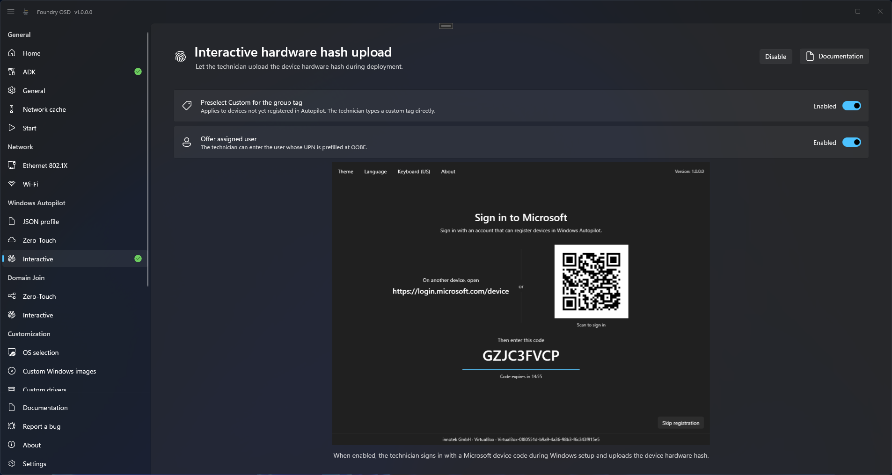

# Interactive hardware hash upload

**Interactive hardware hash upload** lets the technician register the device in Windows Autopilot with their own account. During Windows setup after the restart, before the first sign-in screens (OOBE), the full-screen **Foundry Autopilot Interactive** window opens; the technician signs in, chooses a group tag and registers the device. The deployment media carries no tenant data and no secret.

<figure>
  
  <figcaption>The <strong>Enable</strong> or <strong>Disable</strong> button is in the header. The two switches below it are off by default.</figcaption>
</figure>

## Before you start

Foundry OSD cannot test any of these from the workstation. Check them with one real deployment.

- **A technician account in your tenant.** The window signs the technician in to Foundry's own Microsoft Entra application and asks for permission to read and write Windows Autopilot device settings in Intune (the delegated Microsoft Graph permission `DeviceManagementServiceConfig.ReadWrite.All`). The account must also hold an Intune role that is allowed to import Windows Autopilot devices. Foundry does not check either point: check with your tenant administrator.
- **Sign-in with a code is allowed.** The technician signs in with a code, on a phone or another computer. If a Conditional Access policy blocks this kind of sign-in, the window cannot register the device.
- **Network in Windows PE and after the restart.** In Windows PE, Foundry Deploy checks that the Foundry Autopilot Interactive download is available on GitHub, and downloads it to the device: the device needs Internet access there. After the restart, the window runs in the installed Windows and must reach the Microsoft sign-in and Microsoft Graph hosts. Both are listed in [Network endpoints](../../reference/network-endpoints.md). For Wi-Fi or Ethernet 802.1X, turn on [Windows profile roaming](../network/README.md#windows-profile-roaming): the profile is imported before the window opens.
- **A custom answer file must accept Foundry's command.** The window opens from the [Post-installation](../customization/post-installation.md) console, so a custom answer file must follow [When Foundry adds its command](../customization/unattend/answer-file-rules.md#when-foundry-adds-its-command).

## Configure interactive upload

1. Open **Windows Autopilot > Interactive** and select **Enable**.
2. Turn on the options you need, as listed below.
3. Create or update the deployment media from [Start](../media/README.md).

| Option | Default | Effect |
| --- | --- | --- |
| **Preselect Custom for the group tag** | Off | The window opens its group tag list on **Custom**, with the cursor in the custom box, so the technician types a tag. It applies only to a device that is not registered yet: a device that is already registered keeps its current tag preselected. |
| **Offer assigned user** | Off | The window shows an optional **Assigned user (UPN)** box. The user entered is assigned to the device, and Windows Autopilot prefills the sign-in with it at OOBE for user-driven profiles. Leaving the box empty never removes a user already assigned to a registered device. |

The group tag is otherwise chosen by the technician at each deployment. To send the computer name as well, turn on **Upload computer name to Autopilot** on [Machine naming](../customization/machine-naming.md).

## What the technician sees

Foundry Deploy shows no **Autopilot** step in this mode; the deployment only runs **Prepare Autopilot assistant**. After the restart, the **Foundry Post-installation** console runs the line `Upload hardware hash to Windows Autopilot`, and Foundry Autopilot Interactive opens full screen in front of it. It has no title bar and shows the manufacturer, model and serial number of the device at the bottom.

1. **Sign in.** The technician signs in with a code: the QR code opens the Microsoft sign-in page, which can also be opened from the address shown in the window on another device, and the technician types the code shown in the window there. The QR code does not change; a new code replaces the old one by itself.
2. **Register.** The window shows the signed-in account, with **Use another account**. The technician chooses the group tag, enters the assigned user when offered, and selects **Register**. If the device is already registered, the window says so and preselects its current group tag.
3. **Wait for the profile.** After the registration, the window waits for your tenant to assign the Autopilot profile, for up to 20 minutes. **Continue without waiting** ends the wait.
4. **Continue.** Windows setup continues 10 seconds later, without a restart, or at once with **Continue now**.


The QR code only opens the Microsoft sign-in page: the technician always types the code. Microsoft no longer allows the code to be filled in from a link or a QR code.


**Skip registration**, at the bottom of both pages, asks for confirmation, then lets Windows setup continue without registering the device. See [Windows Autopilot step](../../foundry-deploy/autopilot.md) for the procedure.

## Check the result

- On **Start**, the **Interactive** row of the **Windows Autopilot** card reads "Enabled: interactive hardware hash upload". This only confirms that the mode is enabled.
- After a deployment, find the device by its serial number among the Windows Autopilot devices of your tenant, with the group tag, computer name and user the technician chose.
- The log of the window is `C:\Windows\Temp\Foundry\Logs\AutopilotInteractive\Foundry.AutopilotInteractive.log`. See [Log locations](../../troubleshooting/logs-and-support.md#log-locations).

## Limits

- **Windows setup can continue before the profile is assigned.** The window waits for the profile for up to 20 minutes, then continues anyway, with a message. If the technician selects **Continue without waiting**, or if your tenant does not report the status, OOBE can start before the profile is assigned.
- **The technician chooses the group tag**, including **None**. [Windows Autopilot step](../../foundry-deploy/autopilot.md) says what each choice does to a device that is already registered.
- **The window does not ask twice.** Once the registration is complete, the window does not ask again if Windows setup repeats the step on that installation.
- **The window follows the language, theme and keyboard of Foundry Deploy.**
- **Windows setup waits for the window for up to 120 minutes.** After that, or if the technician skips the registration, Windows setup continues and the device is not registered.
- **Foundry Deploy needs GitHub in this mode.** Without access to the Foundry Autopilot Interactive download, the deployment stops before the disk is erased. See [Windows Autopilot troubleshooting during deployment](../../troubleshooting/autopilot/during-deployment.md#interactive-download-unavailable).

## Related

- [Windows Autopilot step](../../foundry-deploy/autopilot.md)
- [Windows Autopilot](README.md), for the rules shared by the three modes
- [Network endpoints](../../reference/network-endpoints.md)
- [Windows Autopilot troubleshooting](../../troubleshooting/autopilot.md)
