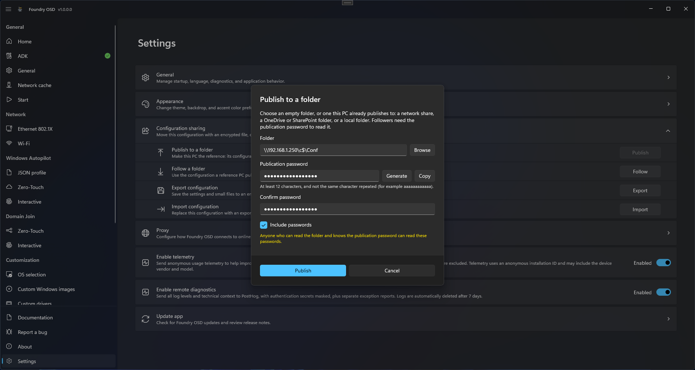

# Publish to a folder

**Publish to a folder** makes this PC the reference: Foundry OSD writes its configuration to a folder, and the PCs that [follow the folder](follow-a-folder.md) apply each new version, read-only.

<figure>
  
  <figcaption>Followers need the folder path and the publication password.</figcaption>
</figure>

## Before you start

- **A folder**: a network share, a OneDrive or SharePoint folder, or a local folder, empty or already published by this PC. This PC writes in it; followers read it.
- **A publication password**, which followers need.
- **A configuration ready to create media**: no row marked **Needs attention** on [Start](../media/README.md).

## Publish

1. Open **Settings**, expand **Configuration sharing**, and select **Publish** on **Publish to a folder**.
2. In **Folder**, type the path or select **Browse**.
3. Type a **Publication password**, or select **Generate**, and type it again in **Confirm password**. **Copy** puts it on the clipboard.
4. Decide on **Include passwords**. With it, the dialog warns: "Anyone who can read the folder and knows the publication password can read these passwords."
5. Select **Publish**. The dialog shows each step with a percentage: "Checking the folder…", then for each item "Verifying \<name\>…" (an image) or "Preparing \<name\>…" (a package or a driver set), then "Sending \<name\>…", and finally "Finishing the publication…".

The card shows "This PC publishes its configuration" and the status "Published. Followers receive this version at their next check." Send the publication password to the followers by another channel than the folder path.

If another PC already publishes to the folder, the **Take over this folder** dialog opens instead: see [Take over a folder](#take-over-a-folder).

## How changes are published

Foundry OSD publishes by itself a few seconds after you change the configuration or an included password. Each publication increases the **Version** on the card.

- A configuration that is not ready, or uses content missing on this PC, is not published: the status reads "Not published: ..." and the previous version stays current.
- Packages, driver sets and images are copied in the background; the card shows the same steps as the dialog. Followers see the version once all its content is written.
- After a failed publish, **Publish now** appears on the card and publishes again at once.

## Change password or reset the publication

Both actions ask for a new password. Each follower then selects **Enter password** once.

| Button | What changes | When followers ask for the new password |
| --- | --- | --- |
| **Change password** | The folder uses the new password. The shared content is not encrypted again, so people who knew the old password can still read it. | At the next published version. Until then they stay **Up to date**. |
| **Reset publication** | The folder uses the new password, and all the shared content is encrypted again. People who knew the old password can no longer read anything. | At once: the reset publishes a new version. |

Use **Reset publication** when someone must lose access: see [Revoke read access](../../reference/security-and-credentials.md#revoke-read-access). Until a reset is published, the card shows "Former readers can still open the content until the next successful publish." When this PC cannot publish at that moment, the card shows "The new password is saved. The change completes at the next successful publish."

## Take over a folder

Taking over continues the publication of another PC from this one, for example when the reference PC is replaced.

1. Select **Publish** on **Publish to a folder** and choose the folder, or select **Take over** on the card when it shows "Another PC publishes to this folder. Take it over to publish from this PC."
2. In **Take over this folder**, check **Version found** and **Key found**, which are not verified yet.
3. Type the **Current publication password**, decide on **Include passwords**, and select **Take over**. The dialog shows the same steps as **Publish**.

Each follower must then [accept the new reference](follow-a-folder.md#accept-a-new-reference) once. The same dialog lets this PC publish again after a Windows password reset made it lose its publication data: see [Configuration sharing troubleshooting](../../troubleshooting/foundry-osd/configuration-sharing.md#passwords-needed).

## Stop publishing

**Stop publishing** opens the **Stop publishing?** dialog: "The folder stays as it is and followers keep the last published version. This PC no longer publishes its configuration." To publish again, use the same folder and publication password.

## Limits

- One reference PC per folder. Another PC publishes there only by taking it over.
- Do not edit, move or delete files in the folder: Foundry OSD manages them.
- What the publication password protects, and what it does not, is in [Security and credentials](../../reference/security-and-credentials.md#configuration-sharing).

## Related

- [Follow a folder](follow-a-folder.md)
- [Configuration sharing](../configuration-sharing.md)
- [Configuration sharing troubleshooting](../../troubleshooting/foundry-osd/configuration-sharing.md)
