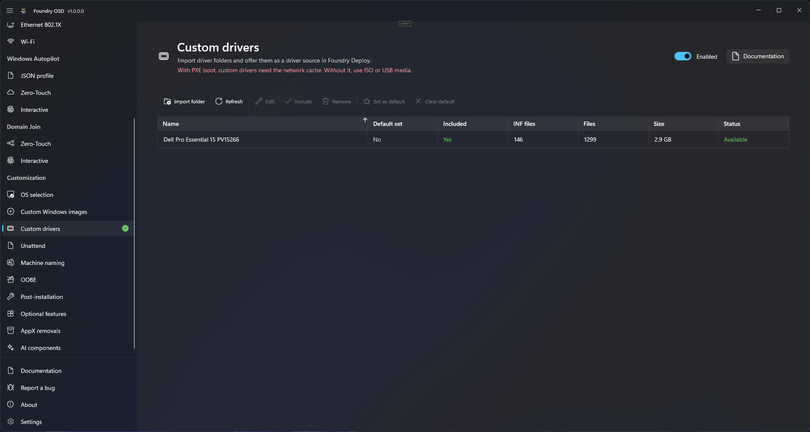

# Custom drivers

**Custom drivers** adds your own driver folders, called driver sets, to the deployment media, so the technician can choose one as the driver source for the deployed Windows. Use it when the driver pack of a manufacturer is older than the drivers on its support site, or when a device has no pack.

<figure>
  
  <figcaption>The driver set library: one set, included in the media and offered by default in Foundry Deploy.</figcaption>
</figure>

Drivers added to Windows PE itself are a different setting: see **WinPE drivers** in [General](../general.md#winpe-drivers).

## Before you start

- **Source.** A folder of `.inf` drivers. Subfolders are allowed, and the folder must contain at least one `.inf` file. Packed content is not supported: no `.cab`, `.zip` or `.exe`.
- **Disk space.** Foundry OSD copies the folder into `%LOCALAPPDATA%\Foundry\Packages\Drivers`, so that drive needs room for the whole folder.
- **Media type.** The page states: "Not available with PXE boot. Custom drivers require the full ISO or USB media."


Foundry does not check the architecture or the models of a driver set. You are responsible for choosing the right drivers: INF files for the media **Architecture** set in [General](../general.md), `x64` or `arm64`, that match your device models. Foundry Deploy only injects the INF files of the folder, and INF files that do not apply are skipped.


## Import a driver folder

1. Open **Customization > Custom drivers** and turn the switch at the top right to **Enabled**.
2. Select **Import folder** in the command bar. The import dialog opens.
3. Select **Browse** and choose the driver folder.
4. Check **Name**. It defaults to the folder name, accepts up to 200 characters and must be unique in the current configuration. Foundry OSD refuses a name already used in it: "A driver set with this name already exists in this configuration."
5. Select **Import**. The dialog shows "Copying and verifying driver files…" with a progress bar, and the percentage done to the right of the bar. Keep the source folder available until the dialog closes. **Cancel**, or closing the dialog, stops the import and adds nothing.

When the import succeeds, the dialog closes and the set appears in the list, included in the media straight away. If the dialog shows an error, read the message under [If something goes wrong](#if-something-goes-wrong) and choose another folder in the same dialog. If the folder content is already in the configuration, the dialog says so ("This folder is already in this configuration as {0}.", where {0} is the name of the existing set) and nothing is added.

The table lists each set with **Name**, **Default set**, **Included**, **INF files**, **Files**, **Size** and **Status**.

## Choose what goes on the media

Select a row, then use the command bar.

| Action | Effect |
| --- | --- |
| **Refresh** | Reads the library again and updates the **Status** of each set. |
| **Edit** | Changes the name of the set. |
| **Include** / **Exclude** | Adds the set to the media you create next, or leaves it out. An excluded set stays in the library. |
| **Remove** | After confirmation, removes the set from the current configuration and deletes its local copy. |
| **Set as default** | Includes the set and marks it as the default. |
| **Clear default** | Clears the default set. |

Excluding the default set clears the default. The original folder and existing media are not changed by **Remove**.

While the page is **Enabled**, Foundry OSD creates media only if at least one set is included and the local copy of every included set is intact. To create media without custom drivers, switch the page off.

On a USB drive, creating or updating the media starts with "Checking the content to copy…" while Foundry OSD checks the files to copy and the free space. With large driver sets this takes a moment: let it finish.

## What the technician sees

In [Select a driver pack](../../foundry-deploy/driver-pack.md), **Custom drivers** is another **Driver source**. The technician picks one set under **Driver set**. When you mark a default set, Foundry Deploy preselects **Custom drivers** with that set, also on virtual machines. Without a default set, the usual pre-selection applies.

During the deployment, Foundry Deploy verifies the set file by file while it copies it to the target device (the step **Stage custom drivers**), then adds it to Windows and to the Windows recovery environment.

## Update a USB drive

An [update](../media/update-usb.md) of a USB drive writes the driver sets of the current configuration to the **Foundry Cache** partition and removes the driver sets the new media no longer uses, including all of them when none remain. Foundry OSD checks the free space before it removes anything, because the previous content is still on the drive. If the update does not fit, it stops with "The USB cache partition does not have enough free space for the updated content, because the previous content stays on the drive during the update. Nothing has been erased or formatted. Create the USB media again instead of updating it." Then [create the USB drive](../media/create-usb.md) again.

If the update succeeds but ends with "Unused custom driver sets could not be removed from the USB drive.", the old sets are still on the drive and keep using space. The next update tries again, or create the USB drive again.

## Check the result

1. On **Start**, check that **Custom drivers** is not marked **Needs attention**.
2. Create or update the media, then deploy a test device of each model the set targets.
3. In Foundry Deploy, check that **Custom drivers** is offered, then that the deployment completes and the device has its drivers: [Verify deployment](../../foundry-deploy/verify-deployment.md).

## Limits

- 256 driver sets per configuration, at most one of them the default. A name accepts up to 200 characters.
- Up to 20,000 files and 20,000 folders per set. Relative paths are limited to 150 characters.
- A set cannot contain a symbolic link, a junction or a cloud placeholder file.
- Foundry Deploy applies one driver source at a time: a set cannot be combined with a manufacturer pack.
- A [publication](../configuration-sharing/publish-to-a-folder.md) carries the driver sets: followers download them in the background. An [exported file](../configuration-sharing/export-and-import.md) carries the list of sets and the default, not their files: on another PC, import the folder again.
- Custom drivers are not delivered to a [PXE boot image](../media/pxe-deployment.md). Foundry Deploy started over PXE does not offer the **Custom drivers** source.

## If something goes wrong

Import errors appear in the import dialog, where you can choose another folder.

| Message | Fix |
| --- | --- |
| "This folder contains no .inf file. Select a folder with INF drivers." | Choose the folder that holds the `.inf` files, not a folder of archives. |
| "A path in this folder is too long or not valid: \<path>. Shorten or rename it, then try again." | Shorten the path to 150 characters or fewer. |
| "This folder contains too many files or subfolders for a driver set." | Keep only the drivers the devices need, or split the folder into two sets. |
| "The local copy of \<name> is missing or damaged. Import the folder again or exclude the set before creating or updating media." | Import the folder again, or select **Exclude**. |
| "The custom drivers on this media failed the integrity check and are not offered. Choose another driver source or rebuild the boot media." | Shown in Foundry Deploy. Choose another driver source, then create or update the media again. |
| "The selected custom drivers are unavailable or failed verification. Reconnect the deployment media, or restart deployment and choose another driver source." | The deployment stopped at **Stage custom drivers**. Reconnect the USB drive or ISO that started the device, or restart and choose another source. |

For failures while the media is written, see [Media creation troubleshooting](../../troubleshooting/media-creation.md).

## Related

- [Select a driver pack](../../foundry-deploy/driver-pack.md)
- [General](../general.md)
- [Update a USB drive](../media/update-usb.md)
- [Start: create deployment media](../media/README.md)
