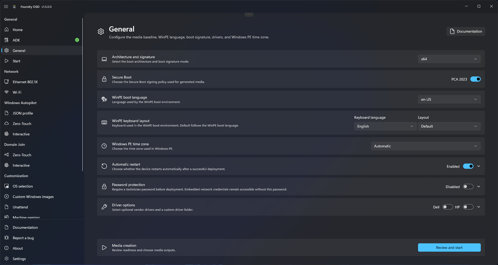

# General

The General page sets the options every deployment media needs: processor architecture, boot signature, Windows PE language, keyboard and time zone, what happens when a deployment ends, an optional password, and extra drivers for Windows PE. The defaults suit a first test; open the page at least once before you create media.

<figure>
  
  <figcaption>The cards of the page in order. <strong>Review and start</strong> opens the Start page.</figcaption>
</figure>

## Before you start

The [ADK](adk.md) page must report **ADK is ready**. Until then **General** cannot be opened.

## Configure the media

1. In the navigation pane, under **General**, open **General**.
2. Set the options below. Each change is saved at once; there is no save button.
3. Select **Review and start** in the **Media creation** card to go to [Start](media/README.md).

| Option | What it does | Default |
| --- | --- | --- |
| **Architecture and signature** | Processor architecture of the media: `x64` or `arm64`. It must match the target devices. | `x64` |
| **Secure Boot** | Certificate that signs the boot files: **PCA 2023** when on, **PCA 2011** when off. | **PCA 2023** |
| **WinPE boot language** | Language of Windows PE, among the language packs installed with the Windows PE add-on. | Keeps your earlier choice. On first use: the language of Foundry OSD when its pack is installed, otherwise the first one available |
| **WinPE keyboard layout** | Keyboard of Windows PE: a keyboard language, then a layout of that language. See below. | **Default**, the keyboard of the WinPE boot language |
| **Windows PE time zone** | Time zone used in Windows PE. See below. | **Automatic** |
| **Automatic restart** | Restarts the device after a successful deployment. | On |
| **Restart delay** | Seconds before that restart, from 0 to 3600. 0 restarts at once. | 10 |
| **Password protection** | Asks the technician for a password before deployment. See below. | Off |
| **WinPE drivers** | Adds the **Dell** or **HP** driver set to the Windows PE boot image only. | Both off |
| **Additional WinPE driver folder** | Optional folder of extra `.inf` drivers added to the Windows PE boot image. | Empty |

### Secure Boot

Keep **PCA 2023** unless you have a reason to change it. Foundry does not check the firmware of your devices: whether a device accepts media signed with the 2023 certificate depends on its firmware, as described in Microsoft's [Secure Boot certificate guidance](https://aka.ms/getsecureboot). If a target device with Secure Boot turned on does not start the media, creating the media again with **PCA 2011** is a test worth making.

### WinPE keyboard layout

The keyboard does not have to match the WinPE boot language. Keep an English Windows PE and type with a Belgian keyboard, for example: select the keyboard language, here **Dutch** or **French**, then the layout, here **Belgian (Period)** or **Belgian French**.

The first list offers every language that has a layout on this computer. The second list shows the layouts of that language. **Default** appears only for the language of the WinPE boot language, and keeps the keyboard that comes with it. Language names follow the language of Foundry OSD; layout names come from Windows, in its display language.

The layout is set for the whole media. A technician who works on another keyboard can switch it in Windows PE from the **Keyboard** menu of [Foundry Connect](../foundry-connect/README.md#menus) or [Foundry Deploy](../foundry-deploy/README.md#menu-bar). This option affects Windows PE only: Windows still asks for the keyboard during its first start.

A profile from another computer can carry a layout that is not installed here. The card then shows "The selected WinPE keyboard layout is not installed on this computer." and media creation is blocked until you choose a layout or **Default**.

### Windows PE time zone

With **Automatic**, Foundry looks up the time zone on the target device, from the public IP address of the deployment network, once Foundry Connect has confirmed Internet access. If the lookup fails, Windows PE uses UTC. The services contacted are listed in [Network endpoints](../reference/network-endpoints.md).

Select a time zone to skip the lookup, for example when the public IP address of the site is located in another region. This option affects Windows PE only, not the installed Windows.

### WinPE drivers

Windows PE only needs drivers for the network and storage hardware it must use. Turn on **Dell** or **HP** for devices of those manufacturers, and add an **Additional WinPE driver folder** for anything else. These drivers reach the boot image only. To add drivers to the deployed Windows, use [Custom drivers](customization/custom-drivers.md).

- The folder must exist and contain `.inf` files, not packed installers.
- Its content, subfolders included, is limited to 2 GiB and to 10,000 files and folders, and must not contain a junction or a symbolic link.
- With `arm64`, a USB drive is always created with the GPT partition style.

## Password protection

Turn on **Password protection** and type the **Deployment password** twice. This is the password the technician types when Foundry Deploy starts; without it, Foundry Deploy does not open.

The password must have at least 8 characters; Foundry OSD recommends 12, or a passphrase. **Review and start** stays disabled until the two entries match.

| Data on the media | Protected by the Deployment password |
| --- | --- |
| Passwords of local Windows accounts set in OOBE | Yes |
| Windows Autopilot JSON profiles | Yes |
| Certificate and its password for the zero-touch Windows Autopilot upload | Yes |
| Custom answer files | Yes |
| Join accounts and passwords of [zero-touch Domain Join](domain-join/zero-touch.md) | Yes. This method requires Password protection. |
| Wi-Fi passwords, and certificates with their passwords for Wi-Fi and Ethernet 802.1X | No |


Network credentials are not protected because Foundry Connect uses them before the password is asked. Anyone who holds the media can read them. Password protection does not encrypt the whole ISO file or USB drive either.


Foundry OSD saves the Deployment password with the configuration while **Remember passwords** is on, which is the default; with it off, the password lasts until you close the app. See [What is remembered](deployment-profiles.md#what-is-remembered). If the fields are empty when you come back, type the password again. If you lose the password of existing media, create the media again with a new one.

## Check the result

[Start](media/README.md) shows one row for each option of this page, from **Architecture** to **WinPE drivers**, with the value you chose. None of them must be marked **Needs attention**.

## Related

- [Start: create deployment media](media/README.md)
- [Security and credentials](../reference/security-and-credentials.md)
- [Foundry OSD application troubleshooting](../troubleshooting/foundry-osd.md)
