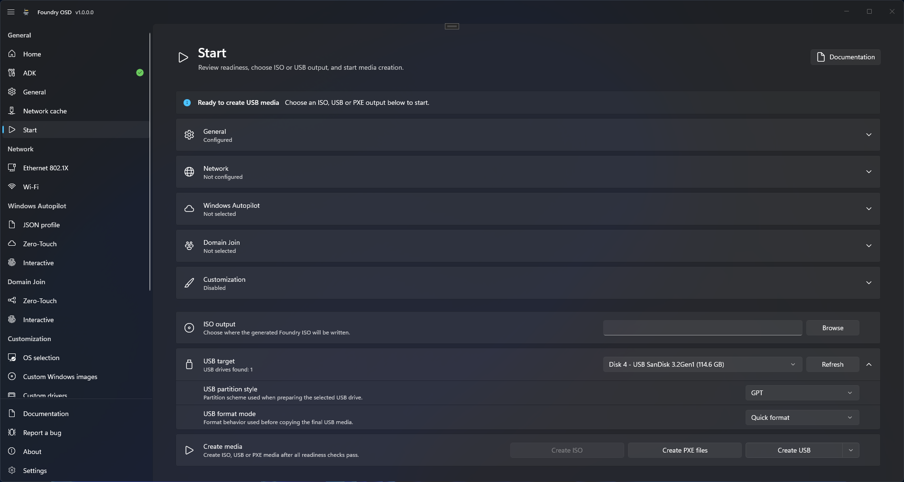
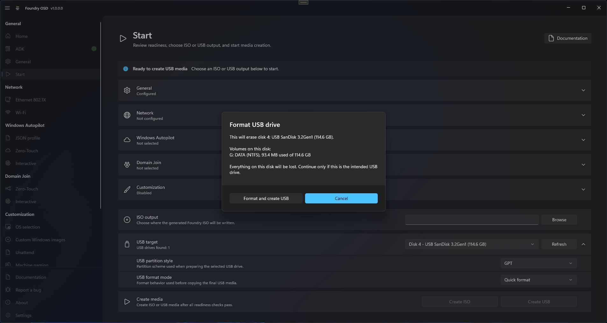

# Create a USB drive

Create a USB drive that starts physical devices and keeps the Windows images and driver packs it downloads, so that later deployments reuse them.

<figure>
  
  <figcaption>The <strong>USB target</strong> card, expanded on its two options, and the <strong>Create USB</strong> button.</figcaption>
</figure>

## Before you start

- No row of [Start](README.md) is marked **Needs attention**, and 20 GB are free on the drives listed in [Start](README.md#before-you-start).
- The drive is sold as 16 GB or more. The list shows sizes with 1 GB = 1,024 MB, so a drive sold as 16 GB shows about 14.5 GB, which is enough. A smaller drive can only be [created without cache](#create-a-drive-without-cache): selecting **Create USB** shows why.


Creating a USB drive erases every partition of the selected disk. Foundry OSD lists every disk connected through USB except the Windows system or boot disk: an external hard disk or SSD, such as a backup disk, is listed too and can be selected. Check the disk number, name and size in the list, then read the volumes that the **Format USB drive** dialog lists before you confirm.


## Create the drive

1. Connect the drive, open **Start**, and select **Refresh** in the **USB target** card.
2. Select the drive in the list. An entry reads, for example, "Disk 4 - USB SanDisk 3.2Gen1 (114.6 GB)".
3. Expand the **USB target** card and set the two [USB target options](#usb-target-options).
4. Select **Create USB**. If the button reads **Update USB**, the drive already is a Foundry USB drive: see [Update a USB drive](update-usb.md).
5. If a dialog titled **Update Foundry OSD before creating boot media** opens, apply the update first or select **Create anyway**.
6. Read the **Format USB drive** dialog, described below. Select **Format and create USB** only if the disk and its volumes are the ones you expect. **Cancel** is the default button, so pressing Enter erases nothing.
7. Keep the drive connected until the dialog is titled **USB media created** and reads "Boot volume: X:. Cache volume: Y:.", with the two drive letters.

<figure>
  
  <figcaption>Check the volumes before you erase: here the disk holds one NTFS volume, DATA.</figcaption>
</figure>

The dialog tells you what is on the disk before anything is erased:

| Line of the dialog | What it tells you |
| --- | --- |
| "This will erase disk \<number>: \<name> (\<size>)." | The disk that will be erased. |
| "Volumes on this disk:", then one line per volume: "\<letter>: \<label> (\<file system>), \<size> used of \<size>" | The drive letter, the label, the file system and the space in use of each volume Windows can read. Foundry OSD reads the disk again just before it opens the dialog. A volume can have no letter, and one without a label reads "No name". |
| "Windows cannot read some partitions on this disk. They may still contain data." | Shown after the list when the disk also holds partitions that Windows cannot read, such as an APFS partition next to a small FAT32 volume on a Mac disk, or a locked BitLocker partition next to a readable volume. The list then shows only part of the disk: treat the disk as holding more data than listed. The Microsoft reserved partition and the BOOT partition of a Foundry USB drive are not counted. |
| "This disk has no partition." | Shown in place of the list when the disk is blank. |
| "Windows cannot read the volumes on this disk. It may still contain data." | Shown in place of the list when the disk has partitions but Windows can read none of them, such as a locked BitLocker drive or a disk formatted for another operating system, or when the disk could not be read. Treat the disk as holding data. |
| "Everything on this disk will be lost. Continue only if this is the intended USB drive." | The last line, above the buttons. |

A volume with data you did not expect, such as a backup, means the wrong disk is selected: select **Cancel**. The same goes for the lines saying that Windows cannot read the volumes or some partitions, unless you know why.

If the disk was removed or replaced since you selected it, the dialog does not open and Foundry OSD shows "The USB drive identity is missing, ambiguous or has changed. Refresh the USB drive list and select the drive again."

## USB target options

| Option | Choices | Default |
| --- | --- | --- |
| **USB partition style** | **GPT** or **MBR**. Keep **GPT** unless you have a reason to change it. Foundry does not check the firmware of your devices: if a device does not offer the drive in its boot menu, creating the drive again with **MBR** is a test worth making. With `arm64`, only **GPT** is offered. | **GPT** |
| **USB format mode** | **Quick format** or **Full format**, applied to both partitions. A full format takes much longer. | **Quick format** |

Foundry OSD remembers both choices for the next drive.

## What Foundry creates on the drive

Two partitions, each with a drive letter in Windows:

- **BOOT**, FAT32, 2 GiB, for the boot files and the boot image. With **GPT** it is an EFI System Partition; with **MBR**, an active FAT32 partition.
- **Foundry Cache**, NTFS, the rest of the drive, for Foundry Connect, the custom images and post-installation content you included, and the Windows images and driver packs that deployments download.

The folders of the cache partition are listed in [What each media type carries](README.md#what-each-media-type-carries).

## Create a drive without cache

A drive without cache works like an ISO written to a USB drive: one FAT32 partition named **FOUNDRY** holds the boot files, the boot image with Foundry Connect, and the custom images, driver sets and post-installation content you included. Devices started from it download Windows and drivers again at each deployment, to the target disk.


**Screenshot required**

- **File:** `foundry-osd-media-create-usb-03-without-cache.png`
- **Capture:** Show the **Create USB** split button open on Start, with its **Create without cache** menu item.


1. Select the drive as for a drive with cache.
2. Open the arrow of the **Create USB** button and select **Create without cache**. With a Foundry USB drive selected, the button reads **Update USB** and the menu item reads **Recreate without cache**: it erases the drive and its downloads.
3. Read and confirm the **Format USB drive** dialog, as above.
4. Wait until the dialog is titled **USB media created** and reads "USB volume: X:. The drive keeps no downloads: each deployment downloads Windows and drivers from the catalog again."

| Rule | Detail |
| --- | --- |
| Drive size | 1 GB or more, and enough to hold the media. Foundry OSD measures the boot files and the imported content before it erases anything, and stops with "The media needs approximately …" when they do not fit. |
| Partition size | The whole drive, up to 32,000 MB (about 31 GB): Windows formats FAT32 only up to 32 GB. The rest of a larger drive stays unallocated. |
| File size | FAT32 holds files up to 4 GiB minus one byte. A larger file, usually a custom Windows image, stops the creation before anything is erased: use **Create USB** for that configuration. |
| Options | **USB partition style** and **USB format mode** apply as for a drive with cache. |

Foundry OSD does not recognize a drive without cache as a Foundry USB drive: the button reads **Create USB** again, and there is nothing to update. Create the drive again after each change of configuration.

## Check the result

1. In File Explorer, check that two volumes named **BOOT** and **Foundry Cache** appear, or one volume named **FOUNDRY** for a drive without cache.
2. Eject the drive, start a test device from it, and check that Foundry Connect opens, then Foundry Deploy.

## Limits

- The boot files must fit the 2 GiB **BOOT** partition, whatever the size of the drive. Foundry OSD checks this before it erases anything. If they do not fit, reduce the drivers or [create an ISO](create-iso.md).
- Foundry OSD checks the identity of the drive again before it writes. If the drive was swapped or reconnected after you selected it, the operation stops and nothing is erased.
- A drive that Foundry OSD recognizes as a Foundry USB drive can only be updated: see [How Foundry recognizes the drive](update-usb.md#how-foundry-recognizes-the-drive). To create it again with a cache, for example to change the partition style, delete its **Foundry Cache** volume in Windows Disk Management, select **Refresh**, and check that the button reads **Create USB**. To create it again without cache, use **Recreate without cache**. Both erase the whole disk, **BOOT** included.

## Related

- [Update a USB drive](update-usb.md)
- [Start: create deployment media](README.md)
- [Media creation troubleshooting](../../troubleshooting/media-creation.md) and [USB drive and device start](../../troubleshooting/media-creation/usb-drive-and-device-start.md)
