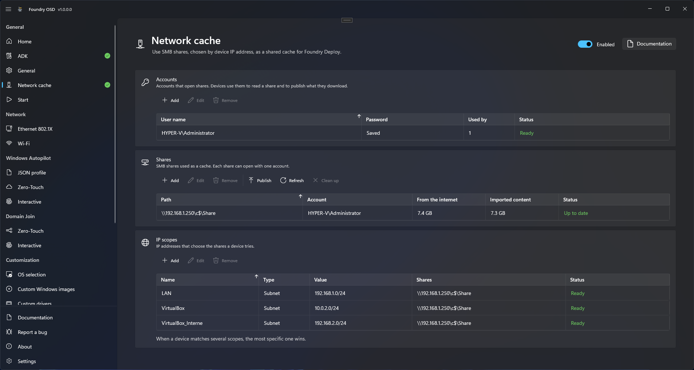

# Network cache

The Network cache page lets Foundry Deploy use SMB shares of your network as a shared cache. Each device picks its shares from its IP address. It reads your imported content from the share only, reads Windows images and driver packs from the share before the Internet, and publishes what it downloads back to the share for the next devices.

You change imported content in Foundry OSD, then select **Publish**: devices pick up the change on their next deployment, with the media they already have.

<figure>
  
  <figcaption>Accounts, then shares, then the IP scopes that choose the shares of each device.</figcaption>
</figure>

## How a device uses the cache

When Foundry Deploy starts, it compares the IP addresses of the device with the **IP scopes** of the page. The most specific scope that contains one of them chooses the shares, and the device tries them in the order of that scope. It keeps the first share that answers for the whole deployment. If the share stops answering during the copy of a file downloaded from the Internet, such as a Windows image or a driver pack, the device downloads that file from the Internet instead.

Before its wizard opens, Foundry Deploy checks that the share answers and that your published content is complete. If it is not, Foundry Deploy stops with one message that says what to fix: see [If a device stops at start](#if-a-device-stops-at-start). Nothing is erased at that point.

For each Windows image, driver pack, driver or firmware file it needs, Foundry Deploy then looks in this order:

1. The cache of the USB drive it started from, when there is one.
2. The share.
3. The Internet. The device then publishes the file to the share, when its account can write there.

| Shared on the cache | Where on the share |
| --- | --- |
| Windows images of the catalog, driver packs, Microsoft Update Catalog drivers and firmware | `Foundry\Downloads\`, published by devices |
| [Custom Windows images](customization/custom-windows-images.md), [custom driver sets](customization/custom-drivers.md) and [post-installation](customization/post-installation.md) content you imported | `Foundry\Cache\`, published by Foundry OSD |

Foundry Deploy checks the hash of every file it reads from a share, while it copies the file to the device, so each file crosses the network once. A Windows image or driver pack that is incomplete or does not match is ignored, and the device downloads it from the Internet. Content you imported has no other source: if it does not match, the deployment stops with an error, after the disk was prepared. Foundry Deploy runs content you imported only when Foundry OSD published it: see [Security and credentials](../reference/security-and-credentials.md#network-cache-publication). Foundry Connect and Foundry Deploy themselves are not taken from the share.

A device that matches no scope, or reaches none of its shares, does not deploy. This protects the disk of a device that would otherwise miss its custom image or its post-installation content. To let such devices go on, add a [backup scope](#backup-scope-for-every-other-device).

## Before you start

- An SMB share for each site, written `\\server\share`. Foundry creates its `Foundry` folder at the root of the share.
- An account that can read, write and delete in that share, both in the share permissions and in the folder permissions. Use an account dedicated to this cache: anyone who can start the media and knows the Deployment password can use it.
- **Password protection** turned on in [General](general.md#password-protection) when a share has an account.
- The devices reach the file server on port 445 from Windows PE: see [Network endpoints](../reference/network-endpoints.md#target-device-in-windows-pe).
- The PC that runs Foundry OSD reaches the shares too, to publish imported content and to measure them or clean them up.

A share without an account is read without credentials and devices never write to it. Current Windows versions refuse guest access to a share by default and require SMB signing, which a connection without credentials cannot provide, so devices can be refused such a share: prefer an account, and test a share without one on a device before you rely on it. Fill such a share from Foundry OSD or from devices of another scope.

## Turn on the network cache

1. In the navigation pane, under **General**, open **Network cache**.
2. Turn the switch at the top right to **Enabled**.
3. Add the accounts, then the shares, then the IP scopes, as described below. Each change is saved at once.
4. If the page shows "Shares with an account require Password protection, because anyone on the network can download a PXE boot image. Turn it on in General.", turn on **Password protection** in [General](general.md#password-protection).
5. Select **Publish**, as described in [Publish](#publish).

Turn the switch to **Disabled** to stop using the cache. The accounts, shares and scopes are kept for later.

### Accounts

Under **Accounts**, select **Add**. Type the **User name**, such as `DOMAIN\user` or `user@domain`, then the **Password** twice, and select **Add**.

When the file server is not in a domain, for example a PC or a NAS in a workgroup, create a local account on that server and give it the rights on the share and on its folder. Type it with the name of the server, such as `FILESERVER\foundry-cache`, even when the share path uses an IP address. Do not use `.\foundry-cache`: the dot names the device that connects, not the server.

The table shows each account with its password state, **Saved** or **Missing**, under **Used by** the number of shares that use it, and its **Status**: **Ready**, or what is missing. To change a password, select the account, then **Edit**: leave the password empty to keep the current one. An account used by a share cannot be removed; remove it from the share first.

The account passwords are passwords of your configuration, saved like the others: see [Saved passwords and files](configuration-sharing/saved-passwords.md). On the media they are protected by the Deployment password; the share paths and user names are not.

### Shares

Under **Shares**, select **Add**. Type the **Path**, such as `\\fileserver\foundry`, choose an **Account** or **No account**, and select **Add**.

A path must start with `\\server\share`, and a share can be listed once. Removing a share also removes it from the IP scopes that use it.

### IP scopes

Under **IP scopes**, select **Add**. **Add** stays disabled until there is a share.

1. Type a **Name**, such as the name of the site.
2. Choose a **Type** and type its **Value**:

   | Type | Value | Example |
   | --- | --- | --- |
   | **Subnet** | A network address and its prefix length, IPv4 or IPv6 | `10.10.0.0/16`, `fd00:10::/48` |
   | **Range** | A first and a last address of the same family, separated by `-` | `10.20.0.10-10.20.0.200` |
   | **Address** | One address | `10.20.0.15` |

3. Under **Shares**, check the shares of this scope and order them with the arrows. Devices use the first checked share that answers, from top to bottom.
4. Select **Add**.

When a device matches several scopes, the most specific one wins: the scope with the fewest addresses. Between two scopes of the same size, the one higher in the table wins.

#### Backup scope for every other device

A device that is in no scope stops at start. To accept every device, add a scope of type **Subnet** with the value `0.0.0.0/0` for IPv4, and a second one with `::/0` for IPv6, and check a backup share in each. The most specific scope still wins, so these scopes only serve the devices that no other scope contains.

## Publish

**Publish** sends your imported content and the settings that select it to every share of the page. Select it each time you change the custom Windows images, the custom driver sets or the post-installation settings, including their defaults, and each time you add a share.

1. On the **Shares** card, select **Publish**. The button is available when the network cache is on and the page shows no error.
2. Follow the **Publishing to the network cache** dialog. It shows one share after the other and has a **Cancel** button.
3. The dialog ends with **Published to the network cache** and "The shares have your latest changes."
4. If the dialog is titled **Publishing to the network cache failed**, it names the shares that did not receive your changes: check that each one is reachable and that its account can write, then select **Publish** again. When it reads "The content to publish could not be prepared.", check the imported content on its page, such as [Custom Windows images](customization/custom-windows-images.md). **Cancel** ends the dialog with **Publishing to the network cache canceled**: select **Publish** again later.

Devices use the new content on their next deployment. You do not create the media again, and you do not redistribute them: an ISO, a USB drive or a PXE boot image you already handed out reads the published content from its share. Creating an ISO, a USB drive or [PXE files](media/pxe-deployment.md) publishes to the shares too.

Only the content is published this way. The accounts, shares and IP scopes travel with the boot image: after you change them, create the media again.

### Publication state of each share

The **Status** column of each share shows one of three states.

| State | Meaning | What devices do |
| --- | --- | --- |
| **Up to date** | The share has your latest changes. | Deploy with your latest changes. |
| **Outdated** | You changed the content since the last publication, or the last publication to this share failed. | Deploy with the previous publication. |
| **Not published** | The share has nothing you published: you never published to it, or its published content was deleted or moved. | Stop at start with [Network cache not available](../troubleshooting/deployment/before-deployment-starts.md#network-cache-not-available). |

While a share is **Outdated** or **Not published**, a warning bar reads "The shares do not have your latest changes. Select Publish.", the **Network cache** item of the navigation pane shows an **Outdated** or **Not published** badge, and the **Network cache** row of [Start](media/README.md) adds the state to its summary. A share whose settings are incomplete shows what is missing in its **Status** column instead.

Each time it measures the shares, Foundry OSD also checks that each share still holds what you published. A share whose content was deleted or moved reads **Not published**, and the bar names it: "`\\fileserver\foundry` no longer has your published content. Select Publish." When a share did not receive the last publication, the bar names it, as in "`\\fileserver\foundry` did not receive your latest changes. Select Publish." Check that the share is reachable and that its account can write, then select **Publish** again.

When the bar says instead that this PC cannot publish because its signing key could not be read or saved, Windows could not open the saved data of this PC, for example after a reset of your Windows password: see [When passwords cannot be restored](configuration-sharing/saved-passwords.md#when-passwords-cannot-be-restored). **Publish** then ends with **Publishing to the network cache failed** and the same text. Media that devices already use keep reading the last publication.

Neither state blocks media creation, because creating media publishes too.

### Several PCs running Foundry OSD

When several PCs run Foundry OSD, use [configuration sharing](configuration-sharing.md) so that they all publish the same configuration. Without it, each PC publishes its own configuration, and each boot image gets the configuration of the PC that created it.

On a PC that [follows a folder](configuration-sharing/follow-a-folder.md), the accounts, shares and IP scopes are read-only, **Publish** is not shown, **Clean up** is unavailable, the shares read **Ready**, and the page never shows **Outdated** or **Not published**: the reference PC publishes. **Refresh** still measures the shares. When the publication leaves out passwords, select an account, then **Edit**, to type its password on this PC. Media created on the follower still copy missing files to the shares.

## Imported content

While the network cache is on with at least one share, the custom Windows images, custom driver sets and post-installation content of your configuration stay on the shares only. ISO files and USB drives no longer carry them: devices take them from their network cache share. Without the network cache, every media carries its content and works on its own.

Foundry OSD publishes this content to every share of the page when you select **Publish** and each time it creates an ISO, a USB drive or [PXE files](media/pxe-deployment.md). The progress dialog of the media then has a last but one step, **Publishing to the network cache**, with the progress of the copy to each share. Only what a share is missing is copied: a file already there with the right size is kept without being read again. Foundry OSD opens each share with its account, or with your Windows account when the share has none.

A share that cannot be reached or written does not make the media fail. The result then adds, for example, "These network cache shares did not receive the imported content: `\\fileserver\foundry`. Check that each share is reachable and writable, then select Publish on the Network cache page." Until you do, devices that use those shares deploy with the previous publication, or stop at start if there is none.

On the device, Foundry Deploy offers the custom images and driver sets of its share, and takes post-installation content from it. A device in no scope, or that reaches none of its shares, stops at start with the message described in [If a device stops at start](#if-a-device-stops-at-start); to deploy such devices, add a [backup scope](#backup-scope-for-every-other-device). To deploy imported content with no share at all, turn the network cache switch to **Disabled** and create the media, which then carries its content.

During the deployment, Foundry Deploy reads each item once: a custom image is copied to the disk by **Resolve custom image**, after **Prepare target disk**, and the post-installation content by **Prepare setup tasks**, each with its progress.

## Space and clean up

Two columns show the space each share uses. Point to a column header to read what it counts.

| Column | What it counts |
| --- | --- |
| **From the internet** | Windows images, driver packs, and Microsoft Update Catalog drivers and firmware that devices downloaded from the Internet and published to the share. **Clean up** deletes them all. |
| **Imported content** | The custom images, custom driver sets and post-installation content that Foundry OSD published. **Clean up** keeps what your configuration or a publication still uses. |

Foundry OSD measures the shares when you open the page; select **Refresh** to measure them again. The columns read **Measuring…** meanwhile. A share that cannot be opened shows **Cannot be reached**, and a share that opens but cannot be read shows **Cannot be read**; **Clean up** is then unavailable for it.

To free space on a share:

1. Select the share.
2. Select **Clean up**. The **Clean up share** dialog names the share and asks to confirm the deletion of its downloads and of the imported content that is no longer used. Select **Clean up** again to confirm.

Foundry OSD deletes every download of the share and the imported content that neither your configuration nor any publication on the share still uses. Content that is still used is kept, including the content that media created by another PC, or before a change of reference PC, still read. Devices download again from the Internet what was deleted, and publish it again.

Files in use, changed since they were published, or not written by Foundry are kept, and a dialog says so: "`\\fileserver\foundry` was cleaned up, but some files were kept because they are in use, changed since they were published, or not written by Foundry."

Content published in the last 24 hours is kept too, in case another PC is still publishing. If the dialog reads "`\\fileserver\foundry` could not be cleaned up. Check that the share is reachable and that its account can delete files, then try again.", fix the access, then select **Clean up** again.

## Several devices at the same time

Devices never wait for each other. When two devices need the same file and the share does not have it yet, both download it from the Internet; the first one to finish publishes it, and the other keeps its own copy. A device reads a file only once it is complete on the share.

A device writes a file under a temporary name and gives it its final name only once it is complete. A temporary file left by a device that stopped is deleted after 24 hours, by the next device that publishes the same file. **Clean up** deletes them too.

A device copies what it downloaded to the share in the background, without slowing the deployment. At the end, during **Finalize deployment**, it waits up to 2 minutes for the copies still running: the step shows the file being copied, its progress, the number of files still waiting and the time left. A copy that does not finish in time is dropped without any message; the next device downloads the file again.


**Share speed**

All the devices that read from or write to a share at the same time share the network card of its server. With a 1 Gbit/s card and ten devices deploying together, each one gets about 100 Mbit/s. To deploy many devices at once:

- Give the file server a 10 Gbit/s network card, or several cards of the same speed, teamed or used through SMB Multichannel. On a NAS, check that it supports SMB 3 Multichannel.
- Store the share on SSD disks.
- Spread the devices over several shares, each with its own IP scope.


## Check the result

1. Open [Start](media/README.md). In the **General** group, the **Network cache** row shows the number of shares and IP scopes, and **Outdated** or **Not published** until you publish. It must not show **Needs attention**.
2. Create the media and deploy a test device whose address is in one of the scopes.
3. In the Foundry Deploy log, look for "Network cache connected", followed by the share and whether the device can write there: see [Logs and support information](../troubleshooting/logs-and-support.md).
4. Deploy a second device in the same scope. Its Windows image and driver pack are read from the share instead of the Internet.
5. Change the default Windows image, select **Publish**, and deploy again with the same boot image: the new default is offered.

## If a device stops at start

Foundry Deploy shows one message, **Network cache not available**, with the cause and the place to fix it, either in Foundry OSD or on the server. For some causes it offers **Retry**; **Close** ends Foundry Deploy without deploying. The four messages, their causes and their fixes are listed in [Network cache not available](../troubleshooting/deployment/before-deployment-starts.md#network-cache-not-available).

## If devices do not use the cache

The Foundry Deploy log says why a device did not use a share:

| Log line | Check |
| --- | --- |
| "Network cache not used. Outcome=NoMatchingScope" | None of the IP scopes contains an address of the device. Add its subnet or range, or a [backup scope](#backup-scope-for-every-other-device). |
| "Network cache share connection failed", with a `Win32Error` | The path, the user name and the password of the account, and that the account can open the share. |
| "Network cache share connection timed out" or "Network cache share did not answer" | That the file server is up and that the device reaches it on port 445. |
| "Network cache connected", with `CanWrite=False` | The share is read, but the device does not publish: give the account the right to write and delete in the share and in its folder. |
| "Network cache content check failed" | The published content is missing or incomplete: select **Publish** in Foundry OSD. |

## Limits

- A share opens with one account.
- The accounts, shares and IP scopes travel with the media: after you change them, create the media again.
- A device keeps one share for the whole deployment.
- Imported content comes from the share only, never from the Internet.

## Related

- [General](general.md)
- [Deploy with PXE](media/pxe-deployment.md)
- [Configuration sharing](configuration-sharing.md)
- [Security and credentials](../reference/security-and-credentials.md)
- [Before the deployment starts](../troubleshooting/deployment/before-deployment-starts.md)
