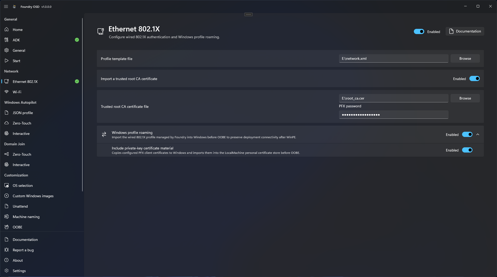

# Ethernet 802.1X

Use this page when the wired deployment network only admits devices that authenticate with 802.1X. Foundry puts a wired profile, and optionally a certificate, on the deployment media. Foundry Connect applies them at startup without asking the technician anything.

<figure>
  
  <figcaption>The profile template, the trusted root CA certificate, and Windows profile roaming with its private-key option. The PFX password and the private-key option only matter for a <code>.pfx</code> file.</figcaption>
</figure>

## Before you start

- **A wired profile exported as XML.** Foundry does not build the profile: the EAP method, the server validation and the credential source all come from this file. Export it on a Windows computer that already authenticates on this network:

  ```
  netsh lan show profiles
  netsh lan export profile folder="C:\Temp" interface="Ethernet"
  ```

  Replace `Ethernet` with the interface name shown by the first command. The second command writes one `.xml` file into the folder.
- **A profile that authenticates the device by itself.** Nothing in Windows PE can ask for a user name and password. A profile that expects typed credentials cannot authenticate. Use computer authentication, typically with a certificate (EAP-TLS).
- **The certificate file, if the profile needs one**: a root CA certificate (`.cer` or `.crt`), or a client certificate with its private key (`.pfx`) and its password.

## Configure wired 802.1X

1. Open **Network > Ethernet 802.1X**.
2. Turn on the switch at the top of the page, next to **Documentation**. It shows **Enabled** and unlocks the fields.
3. In **Profile template file**, select **Browse** and choose the exported `.xml` file.
4. If the profile needs a certificate, turn on **Import a trusted root CA certificate**. In **Trusted root CA certificate file**, select **Browse** and choose the file.
5. For a `.pfx` file, type its password in **PFX password**. Leave the box empty for a `.cer` or `.crt` file.
6. To keep the connection in the installed Windows, turn on **Windows profile roaming**. See [Windows profile roaming](README.md#windows-profile-roaming) for what is imported and when.

The certificate field has one label for two uses. The file type decides what Foundry Connect does with it:

| File you select | What happens in Windows PE |
| --- | --- |
| `.cer` or `.crt` | The certificate is added to the trusted root certification authorities. |
| `.pfx` or `.p12` | The client certificate and its private key are imported into the personal store of the local computer, using **PFX password**. |

## What the technician sees

Nothing to do. When it starts, Foundry Connect imports the certificate, adds the wired profile and asks every Ethernet adapter that has a cable connected to reconnect.

The **Ethernet** card of Foundry Connect has an **802.1X** row:

| On screen | Meaning |
| --- | --- |
| **Authenticating** | The network is checking the device. |
| **Authenticated** | The network accepted the device. The card then shows **Connected** once the address arrives. |
| **Profile applied** | The profile is in place, but Foundry Connect cannot read the result. An address under **IPv4** means that it worked. |
| **Authentication failed** | The profile from the media or the network refused the device. A box under the details gives a short reason. |
| **Unavailable** | The profile cannot be used from this media, for example because the certificate password cannot be read. The box says to recreate the media. Plain Ethernet and Wi-Fi keep working. |

See ["Authentication failed"](../../troubleshooting/network.md#wired-authentication-fails) when the device is refused.

<!-- TODO lot 4: describe the Deployment password prompt that Foundry Connect shows at startup when wired 802.1X needs a protected secret, and what Cancel does. -->

## Check the result

- In Foundry OSD, **Start** does not report "Network configuration is not ready."
- On a device connected to a production switch port, the **Ethernet** card in Foundry Connect shows **Connected** and **802.1X** shows **Authenticated** or **Profile applied**, then the status at the top shows **Network ready**.

## Limits

- One profile file and one certificate file. You cannot supply both a root CA file and a client `.pfx` file. From a `.pfx` file, Foundry Connect imports the client certificate only: the issuing CA is not added to the trusted roots.
- Foundry OSD checks that the files exist. It does not check the content of the profile or the PFX password. A mistake shows only in Windows PE.
- The files are readable on the media, and Foundry OSD keeps the **PFX password** between sessions only while **Remember passwords** is on. See [What goes on the media](README.md#what-goes-on-the-media).

<!-- TODO lot 4: update the limits above, the certificate steps and table in Configure wired 802.1X, and the screenshot foundry-osd-network-ethernet-01-profile-configuration.png for separate client and trusted root certificate fields and protected network secrets. -->

## Related

- [Network](README.md)
- [Network readiness in Foundry Connect](../../foundry-connect/network-readiness.md)
- [Network and Foundry Connect troubleshooting](../../troubleshooting/network.md)
