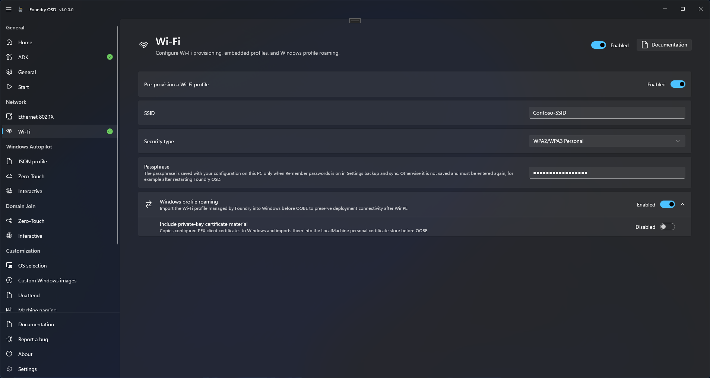
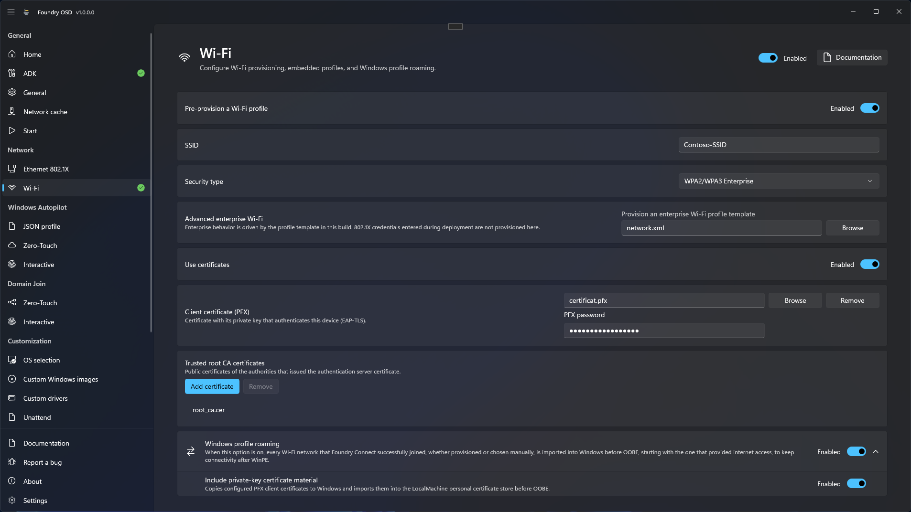

# Wi-Fi

The Wi-Fi page does two separate things. Its main switch adds Wi-Fi support to the boot image, so the technician can join a wireless network in Foundry Connect. **Pre-provision a Wi-Fi profile** also puts one profile on the deployment media, so the device connects without anyone typing a passphrase.

<figure>
  
  <figcaption>Wi-Fi support enabled, with a WPA2/WPA3 Personal profile and Windows profile roaming turned on.</figcaption>
</figure>

## Before you start

- **Enabling Wi-Fi adds wireless support to the boot image.** Every boot image is built from the Windows Recovery Environment (Windows RE), which can join a wireless network once Foundry adds the files and the driver it needs. See [What decides the boot image](../media/create-iso.md#what-decides-the-boot-image). If no Windows RE can be obtained, an `x64` media falls back to the standard Windows PE image, which has no Wi-Fi.
- **Check the Wi-Fi adapter driver.** Foundry adds the latest Intel wireless driver package from its driver catalog. For any other adapter, put its driver in the **Additional WinPE driver folder** on the [General](../general.md) page.
- **For an enterprise network (802.1X), export the profile as XML** on a Windows computer that already connects to it:

  ```
  netsh wlan show profiles
  netsh wlan export profile name="Contoso-Corp" folder="C:\Temp"
  ```

  Nothing in Windows PE can ask for a user name and password: use a profile that authenticates by itself, with a certificate.

## Enable Wi-Fi

1. Open **Network > Wi-Fi**.
2. Turn on the switch at the top of the page, next to **Documentation**. It shows **Enabled** and unlocks the page.

Stop here if technicians join an open or passphrase network themselves. An enterprise network always needs an embedded profile.

## Embed a profile

1. Turn on **Pre-provision a Wi-Fi profile**.
2. In **SSID**, type the network name exactly as it is broadcast, including upper and lower case.
3. Choose the **Security type** and fill in what it asks for:

| Security type | What you provide |
| --- | --- |
| **Open** | Nothing. |
| **OWE (Opportunistic Wireless Encryption)** | Nothing. |
| **WPA2/WPA3 Personal** | **Passphrase**, 8 to 63 characters. It requires [Password protection](../general.md#password-protection). |
| **WPA2/WPA3 Enterprise** | The exported profile file. |
| **WPA3 Enterprise (WPA3ENT)** | An exported profile whose authentication is `WPA3ENT`. |
| **WPA3 Enterprise 192-bit (WPA3ENT192)** | An exported profile whose authentication is `WPA3ENT192`. |

For the three enterprise types, two more cards appear:

- **Advanced enterprise Wi-Fi**: select **Browse** and choose the exported `.xml` file. The **SSID** above must match the network in that file. For the two WPA3 Enterprise types, Foundry OSD reads the `authentication` value of the file and refuses a file that does not match.
- **Use certificates**: turn it on if the profile needs a certificate. Two cards appear:
  - **Client certificate (PFX)**: the certificate with its private key that authenticates the device (EAP-TLS). Select **Browse**, choose one `.pfx` or `.p12` file and type its password in **PFX password**. **Remove** clears it. A client certificate requires [Password protection](../general.md#password-protection).
  - **Trusted root CA certificates**: the public certificates of the authorities that issued the certificate of the authentication server. Select **Add certificate** for each `.cer` or `.crt` file. To take one out, select it in the list, then **Remove**. "No trusted root CA certificate added." is shown while the list is empty.

Turn on **Use certificates** only with at least one certificate in one of the two cards: otherwise the page shows "Enterprise Wi-Fi requires a client certificate or a trusted root CA certificate when certificates are used." In Windows PE, Foundry Connect imports the client certificate into the personal store of the local computer and adds each trusted root to the trusted root certification authorities.

When you open a configuration that holds a single certificate file, Foundry OSD shows it under the matching card: a `.pfx` or `.p12` file under **Client certificate (PFX)**, with its password, and any other file under **Trusted root CA certificates**.

<figure>
  
  <figcaption>With <strong>WPA2/WPA3 Enterprise</strong>, the profile template drives the connection. The client certificate and the trusted roots are two separate cards.</figcaption>
</figure>

To keep the connection in the installed Windows, turn on **Windows profile roaming**, with or without an embedded profile. See [Windows profile roaming](README.md#windows-profile-roaming) for what is imported and when.

## What the technician sees

Foundry Connect shows a **Wi-Fi** card with the networks in range and, for the embedded profile, a **Provisioned Wi-Fi** card.

- Foundry Connect connects the embedded profile by itself only while the device has no Internet access, so a working cable is used first. It keeps trying until the technician connects or disconnects a network by hand. After that, the technician selects **Connect** on the **Provisioned Wi-Fi** card to use the profile again.
- Networks that hide their name are not listed in Foundry Connect. To use one, embed its profile here.
- When the media holds a profile that Foundry Connect cannot use, for example a passphrase it cannot read, the card shows **Unavailable** with a hint to recreate the media. The other connections are not affected.
- With a passphrase, a client certificate, or an enterprise profile file that contains key material, the **Provisioned Wi-Fi** card shows **Password required** until the technician types the Deployment password. Foundry Connect asks for it by itself once, only when the device has no Internet access and the network is in range, and again each time the technician selects **Connect** on the card. If the technician selects **Cancel**, the profile stays unused; the other connections are not affected. One correct entry is enough: Foundry Deploy does not ask again.

See [Network readiness](../../foundry-connect/network-readiness.md#use-the-provisioned-wi-fi) and [Deployment password in Foundry Connect](../../foundry-connect/README.md#deployment-password-in-foundry-connect).

## Check the result

- In Foundry OSD, **Start** reports neither "Network configuration is not ready." nor "Required media secrets are not ready."
- On a device with no cable, Foundry Connect shows **Network ready** and, next to it, **Provisioned Wi-Fi ·** followed by the SSID. The **Provisioned Wi-Fi** card shows **Connected**.

## Limits

- One embedded profile per media.
- Enterprise profiles: one client certificate and any number of trusted root CA certificates. From a `.pfx` file only the client certificate is imported, not its issuing CA: add that CA under **Trusted root CA certificates**. Foundry OSD checks neither the PFX password nor the content of a **WPA2/WPA3 Enterprise** profile: a mistake shows only in Windows PE.
- The **Passphrase** and the client certificate with its **PFX password** need Password protection, and anyone who knows the Deployment password can recover them from the media. See [What goes on the media](README.md#what-goes-on-the-media).
- On protected media, the client certificate file, and an enterprise profile file that contains key material, must not be empty and must stay under about 3 MB. Otherwise media creation stops with an error.

## Related

- [Network](README.md)
- [Network readiness in Foundry Connect](../../foundry-connect/network-readiness.md)
- [Network and Foundry Connect troubleshooting](../../troubleshooting/network.md)
